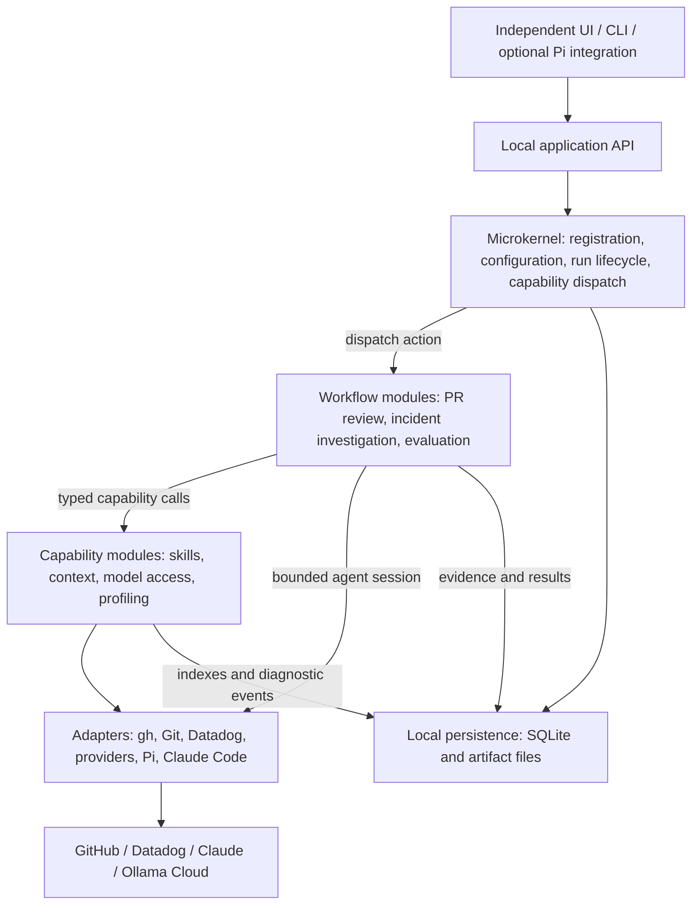
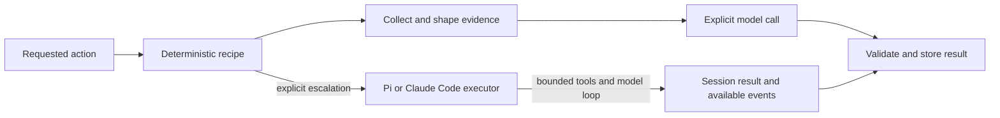
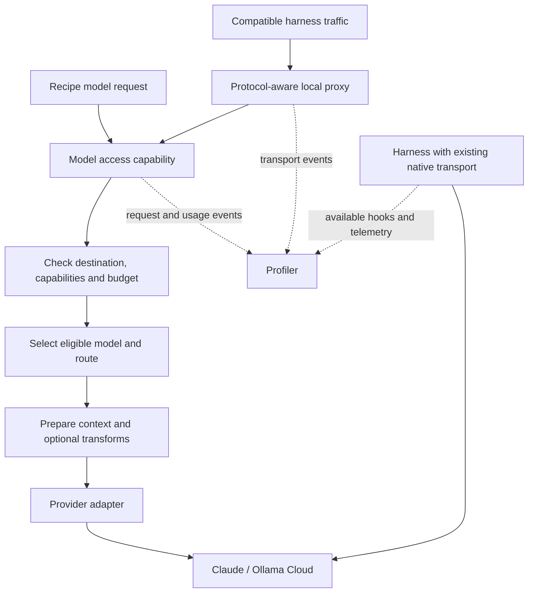
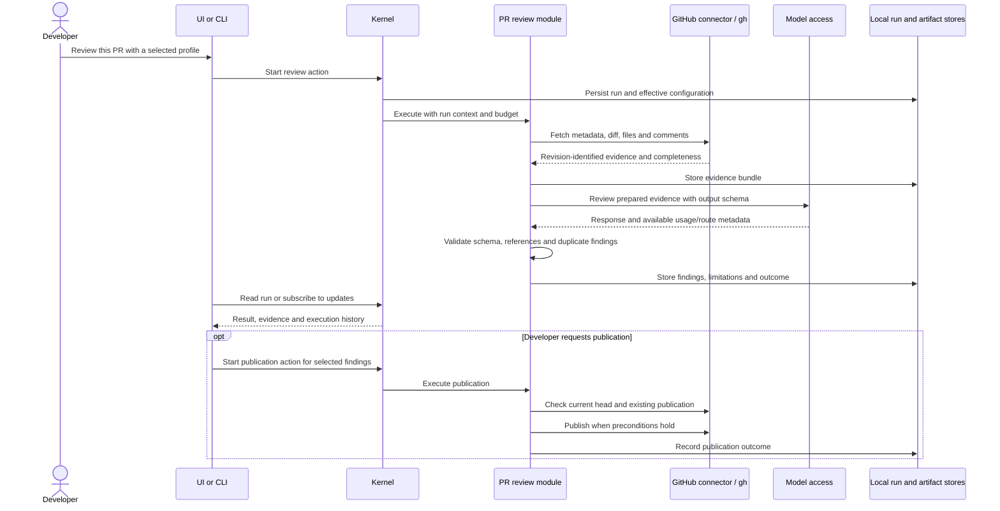
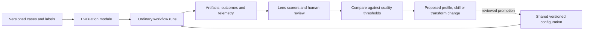
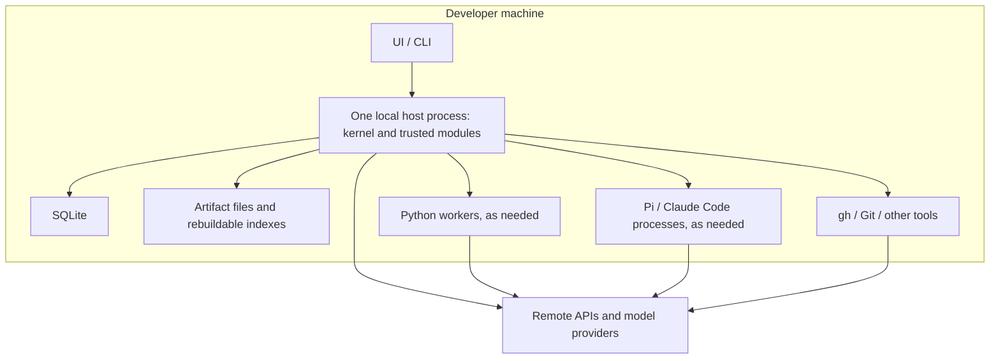

# Local agent workbench: high-level architecture

Status: proposed design, 22 October 2026. This describes the intended system, not capabilities already implemented in agentic-hub. See [the research report](local-agent-workbench-research.md) for upstream references and evaluation details.

## Architectural shape

Build a local modular application around a small microkernel. One background process hosts the kernel and trusted modules. An independent UI, CLI, and optional harness integrations are clients. Python workers and harness processes are spawned when needed. Modules are code boundaries; they do not each require a service or process.

The workbench owns runs, evidence, configuration and results. A harness owns its agent loop and native session. A provider owns model execution. Keep these three responsibilities separate.

Arrows represent runtime calls or writes, not permission to import another module's internals. Storage access uses owned repositories and shared artifact/run interfaces. Modules do not read each other's private tables.

The UI can change without replacing orchestration. Pi can be removed without losing run history or disabling deterministic recipes. The gateway can be bypassed for an incompatible authentication path without losing workflow execution or all telemetry.

## What belongs in the kernel

The kernel provides only the mechanisms every module needs:

| Responsibility | Scope |
|---|---|
| Module registration | Module identity/version, contract compatibility, explicit capability bindings |
| Configuration | Resolve company, user and repository configuration into a recorded effective configuration; enforce administrator constraints where required |
| Run lifecycle | Run/parent IDs, durable job state, deadlines, cancellation and concurrency limits |
| Capability dispatch | Locate registered actions and services; check declared requirements and permissions |
| Shared records | Access to run metadata, artifact references and a small event interface |

The kernel does not know what a good PR finding is, how Datadog queries work, which model is best, how to compress logs, or how to score an evaluation. Those decisions belong in modules.

A shared runner provides step recording, cancellation and retry helpers. Workflow modules supply ordinary TypeScript or Python code that chooses the steps. Do not build a custom workflow language initially. The kernel does not need to interpret every operation in a workflow.

## Modules and ownership

| Module | Owns | Uses |
|---|---|---|
| Skill hub | Catalog, pinned versions, compatibility metadata, host-specific distribution | Git source adapter, artifact store |
| Repository/service context | Incremental indexes, service mappings, evidence selection, freshness | Git/filesystem, documentation and service connectors |
| PR review | Review recipe, finding schema, review validation, publication action | GitHub connector, context, skills, model access |
| Incident investigation | Bounded investigation recipe, hypotheses and evidence validation | Datadog connector, service context, model access |
| Evaluation | Datasets, experiments, lens packs, scorers, comparisons | Existing workflow actions, artifacts, telemetry, replaceable evaluation runner |
| Model access | Request eligibility, model execution contract and transport coordination | Routing policy, transforms, provider adapters |
| Routing | Versioned task profiles, eligibility/ranking, fallback decisions | Capabilities, budgets and approved evaluation results |
| Context transforms | Content-specific reduction/compression and links to originals | Evidence artifacts and context budgets |
| Profiler/observability | Trace ingestion, correlation, usage analysis and derived metrics | Workflow events, harness events, proxy events |

Modules can expose commands and read models to any UI. Use shared views for runs, evidence, findings and comparisons before inventing a dynamic UI-plugin framework.

Later workflow modules can add CI investigation, change-impact analysis, contract checks and reproducer verification by reusing these capabilities.

## Two execution paths

**Recipe execution is the default.** Code selects sources, collects evidence, handles pagination, applies budgets, invokes a model at a named step and validates the output. The current PR reviewer remains in this category. A workflow can also complete with no model calls at all.

**Agent execution is an explicit option.** A harness handles exploratory work with a specified repository, tool policy, time budget and stopping condition. The adapter maps native session events into workbench events and retains native metadata. If a backend cannot enforce a required restriction, that action is unavailable on that backend.

Separate the contracts:

- `Action`: start a named workflow with validated inputs.
- `ContextProvider`: return attributable evidence for a query and snapshot.
- `ModelClient`: request one model interaction through a compatible execution path.
- `HarnessExecutor`: run or resume an agent session with declared limits.
- `ContextTransform`: derive a bounded representation while retaining provenance.
- `TelemetrySink`: receive diagnostic events.

These are design-level ports, not a promise that every provider accepts identical messages or settings. Preserve native options under adapter-specific configuration. Provider protocols, authentication and harness session formats stay behind adapters. The existing working Pi/Enterprise Claude integration remains usable; a direct model API adapter requires its own supported authentication path.

## Model gateway and proxy

Separate the shared model-access capability from its HTTP proxy entry point. Internal recipes call the capability directly. Compatible external harnesses enter through the proxy. Both can reuse routing, request policy, transforms and telemetry without sending internal calls through an unnecessary HTTP hop.

Model eligibility first checks required capabilities and destination policy. Preparation then fits the selected route's budget. If it cannot, explicitly select a different eligible route or fail; do not silently truncate critical evidence. Record original/transformed artifact IDs and all routing decisions.

Proxy calls may not expose a full task or session context. For those calls, preserve the native protocol and default to observation/pass-through. Enable routing or rewriting only where the adapter can maintain required semantics. Hidden transformations would make evaluation and debugging unreliable.

Keep one owner for retries and fallback at each boundary, with a total attempt budget. A streamed or partially executed agent turn must not be blindly replayed through a different model. Native harness sessions can retain their model selection; the workbench records that the choice is harness-owned.

The proxy is useful for capture, eligible routing, request limits and compatible transformations. It cannot by itself reconstruct all tool execution, task intent or workflow outcomes. Those observations come from the workflow and harness layers.

## Shared information model

Use a few stable records across every workflow:

| Record | Purpose |
|---|---|
| Run | What was requested, effective configuration, snapshot, state and parent run |
| Step/attempt | What code executed, with which inputs, outcome, timing and retries |
| Evidence bundle | Attributable inputs with revisions/time windows, hashes, included/omitted data and freshness |
| Artifact | Immutable content referenced by runs, evidence, findings or experiments |
| Finding | Claim, supporting/contradicting evidence, location and validation status |
| Model call/decision | Requested and actual model, settings, route/transform decisions and observed usage |
| Experiment | Dataset/candidate/lens versions, run references and per-case results |

Store queryable metadata in SQLite and larger payloads in local files. Begin with text search and relational graph edges for context. Keep indexes rebuildable. Keep durable run/publication records independent of best-effort profiling events: a dropped trace must not erase whether a workflow completed or published a comment.

Thread run/step/call IDs through adapters wherever possible. Mark unattributed external traffic and missing usage explicitly; do not guess correlations or substitute zero for unknown cost.

Credentials remain in existing tool authentication stores or the OS credential store. Persist credential references, not secrets in experiment snapshots or traces. Configure capture and retention separately for metadata and raw code/log bodies. Local execution still sends selected evidence to configured cloud models when a workflow calls them.

## A PR review from start to finish

The existing Python reviewer is the initial worker. First expose its hardcoded model through configuration while retaining the current default. Preserve the baseline collection, prompt and no-tools behavior before experimenting with retrieval or agent escalation.

A publication is a separate action with explicit inputs and revision checks. If the result of an external write is unknown after a crash, reconcile with GitHub before retrying. Do not assume local idempotency keys make a remote API exactly-once.

## Evaluation as the improvement loop

Evaluation runs the same workflow actions that developers use. An experiment creates child runs with pinned candidates and evidence fixtures, then applies deterministic scorers, calibrated judges or human review.

Profiler events describe execution. Evaluation supplies outcome judgments. Routing consumes approved task-specific results. Keep those responsibilities separate so a small experiment cannot silently rewrite every developer's routing policy.

Recorded-response replay tests deterministic orchestration. Fresh model runs measure current stochastic outcomes. Label them separately. The first lenses should cover correctness, grounding, coverage, contract adherence, uncertainty, robustness, efficiency and stability.

## Physical deployment

TypeScript with Bun is the proposed host implementation, subject to a small compatibility spike. Keep Python workers where they already provide value. Do not rewrite the existing skill hub or reviewer merely to standardize language. Go is a future component option when justified; Rust is outside the team's scope.

Use typed in-process calls for trusted TypeScript modules and versioned JSON messages for subprocess workers. If a browser UI is chosen, expose a loopback API with authenticated local access and origin checks; stream run updates through a simple event channel. A UI disconnect should not automatically kill a durable run.

The host owns a bounded queue and durable job states. On restart, mark unfinished runs interrupted and resume only steps whose effects are understood. Trusted in-process plugins have the host's permissions; a manifest is not a security sandbox. Repository code execution or untrusted workers require an actual isolation boundary.

Company Git holds reviewed skills, profiles, recipes and suitable evaluation fixtures. Developers pin versions locally. Raw traces and incident logs stay local by default; team comparisons can use deliberate sanitized exports. There is no always-on company service in this design, so a sleeping laptop cannot provide continuous monitoring.

## Boundary checks

The architecture is working if these changes remain local:

- Replacing the UI changes clients, not review or evaluation logic.
- Removing Pi leaves recipes, evidence and run history usable.
- Adding a provider changes an adapter and capability metadata, not the kernel.
- Replacing the evaluation runner changes its adapter, not every workflow.
- Adding CI investigation mostly reuses GitHub, context, model access and findings.
- Disabling compression still allows model calls; disabling profiling still allows durable runs.
- A module cannot depend on another module's private database schema.

The first implementation should prove these boundaries with one complete PR-review flow and a baseline comparison. It should not prebuild every abstraction or module before that flow works.
