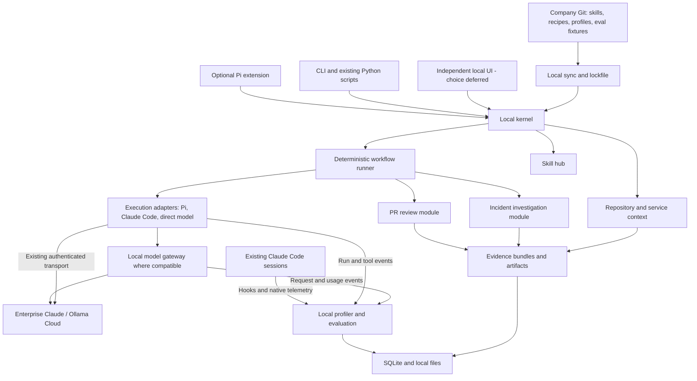

# Local AI workbench: research and architecture proposal

Research date: 21 October 2026. This is an architectural recommendation based on upstream documentation and selected repository materials, not a runtime benchmark or a security audit. Features on upstream `main` may differ from installed releases.

## Recommendation

Build a **local developer workbench with a small, harness-independent extensible core**. Treat Pi and Claude Code as optional execution adapters and integration surfaces. Keep the UI decision open; a separate local UI can consume the same contracts as the CLI. Share skills, recipes, model profiles, and evaluation fixtures through a company Git repository. Keep runs, credentials, repository indexes, and captured logs on each developer's machine by default.

All eight original capabilities, plus evaluation, belong in the design. Their shared foundation is a versioned run record and an evidence bundle: a finite, attributable collection of inputs that deterministic code prepares and a model interprets. The company uses Python and TypeScript with Bun, is considering Go, and excludes Rust. GitHub integration should use the gh CLI.

The user confirmed that Pi already works with Enterprise Claude in their environment. Preserve that working authentication integration. Proxy compatibility remains a separate integration test; do not replace working authentication merely to achieve interception.

This scope calls for SQLite, local files, a few child processes, and a small package registry in code. It does not currently justify a hosted control plane, Kubernetes, a company identity service, a network message broker, or a plugin marketplace.

## What the reference projects contribute

| Reference | Useful evidence from the project | How I would apply it |
|---|---|---|
| [agentic-hub](https://github.com/AGomezGranda/agentic-hub) | Shared skill bodies, generated host-specific instructions, installation/status handling, and a Textual TUI. | Reuse the distribution and adaptation concepts. Add pinned versions, compatibility declarations, and evaluation results. Keep the existing implementation where useful. |
| [AI Agent Profiler](https://github.com/rguiu/ai-agent-profiler) | Local traffic capture, session attribution, context/cost analysis, and comparison workflows. Its docs describe limitations in concurrent attribution for some transports. | Borrow the capture/derive separation and explicit session identity. Combine proxy observations with harness events rather than treating traffic as a complete execution trace. |
| [OmniRoute](https://github.com/diegosouzapw/OmniRoute) | Routing, fallbacks, cache affinity, provider interoperability, and explainable routing metadata. | Evaluate as a replaceable gateway. Select the subset needed for Claude and Ollama Cloud; do not import the whole product's feature surface into the kernel. |
| [Open Code Review](https://github.com/alibaba/open-code-review) | Deterministic selection/grouping/rule matching around a reviewer with bounded tools; structured line-level findings. | Compare against your existing script. Borrow selective context retrieval and coverage accounting without assuming an agent loop always improves review. |
| [Graphify](https://github.com/Graphify-Labs/graphify) | Deterministic tree-sitter code mapping and distinct extracted/inferred relationships. | Use structural extraction for navigation, then attach documented intent from ADRs, discussions, and runbooks. Evaluate coverage for your languages. |
| [Headroom](https://github.com/headroomlabs-ai/headroom) | Content-specific compression, cache-aware mechanisms, and retrieval of retained originals. | Trial transformations on explicit content types. Measure task quality and total workflow cost, including retrieval and cache misses. |

These are candidates and design references, not six components to chain blindly. Avoid a stack of separate routing, capture, and compression proxies when one transport layer can expose the relevant extension points. Claims of speed, accuracy, and savings in project documentation need testing on your own workloads.

## Harness independence, with Pi as an optional integration

The former `badlogic/pi-mono` URL currently redirects to [earendil-works/pi](https://github.com/earendil-works/pi). Its package boundaries include the coding agent, provider API, agent core, terminal UI, telemetry, and additional runtime libraries. Package names and APIs should be pinned to the release you actually adopt.

The workbench should own actions, run IDs, evidence, profiles, and persisted results. Pi sessions are adapter-owned details referenced by a run; they are not the workbench's canonical data model. A recipe that collects a PR and makes one model call does not need an agent harness at all. Keep `ModelTransport` (one model interaction) separate from `Executor` (a harness-owned session or loop). Each adapter declares supported features, such as structured output, restricted tools, streaming events, resume, and cancellation; unsupported requirements should fail explicitly rather than silently change behavior.

An optional company Pi extension/package can register commands such as `/hub review`, `/hub investigate`, `/hub skills`, `/hub context`, and `/hub runs`, delegating to the independent workbench. Typing a command should not require a model to decide which deterministic workflow to start. Add model-callable tools only where conversational discovery or bounded investigation is useful. Pi exposes command/tool registration and hooks around model requests, tool execution, and session lifecycle. Its hooks are suitable for attribution and result shaping; slow work in streaming hooks would delay the stream. [Pi extensions](https://github.com/earendil-works/pi/blob/main/packages/coding-agent/docs/extensions.md).

Use its SDK when TypeScript integration needs direct session access. Use RPC when a subprocess boundary is useful, especially for a browser-backed agent session. A Pi TUI extension does not automatically become a browser component: RPC supports certain UI requests, while custom terminal components and several terminal-specific methods are unavailable. [Pi SDK](https://github.com/earendil-works/pi/blob/main/packages/coding-agent/docs/sdk.md), [RPC UI limitations](https://github.com/earendil-works/pi/blob/main/packages/coding-agent/docs/rpc-extension-ui.md).

There are two additional upstream packages worth investigating before writing infrastructure. Chord provides typed contracts and cross-process state/RPC; pi-durable provides persisted agent tasks but explicitly labels its API experimental. Neither is necessary for a first version built from ordinary module interfaces and a local job table. Do a narrow spike if their capabilities replace actual work; avoid adopting hot reload and replicated state just because they exist. [Chord](https://github.com/earendil-works/pi/blob/main/packages/chord/README.md), [pi-durable](https://github.com/earendil-works/pi/blob/main/packages/durable/README.md).

Pi extensions run with the Pi process's OS permissions. A module manifest describes intended access; it cannot sandbox arbitrary JavaScript. For trusted company extensions, this can be an acceptable local trust model. Untrusted code or repository test execution needs a separate process/container with constrained filesystem and network access. [Pi permission model](https://github.com/earendil-works/pi#permissions--containerization).

## Architecture: logical modules, few processes

The diagram shows boundaries, not a requirement for a service per box. TypeScript with Bun is the first candidate for contracts and coordination because it matches the team's skills; a short compatibility spike should cover subprocess cancellation, streaming, persistence, packaging, and chosen dependencies. Use a local process owning SQLite and optional HTTP endpoints, and child workers only where needed. Reuse the Python review script as a JSON-in/JSON-out worker. Python is also suitable for extraction and evaluation. Introduce Go only for a concrete component need, such as deployment or runtime constraints that the initial implementation cannot meet. Rust is excluded by the team's constraints.

The independent CLI or UI can start the local process on demand; a Pi integration can connect to the same process. Use a per-user lock to avoid competing daemon instances. Persist jobs before dispatch, update state transactionally, bound concurrency, and show interrupted runs after a crash or laptop sleep. Resume safe read-only steps from their recorded inputs; never automatically repeat a publication or mutation whose outcome is unknown.

Implement a GitHub connector around gh, reusing its existing authentication. Prefer structured output, use gh api for endpoint-specific retrieval, handle pagination, and preserve commit IDs and completeness information in evidence. Invoke subprocesses with argument arrays and explicit deadlines. Keep GitHub acquisition in this connector so PR review, CI triage, context mapping, and dataset curation share it. The CLI supports authenticated API calls and pagination; endpoint limits still need explicit handling. [gh api documentation](https://cli.github.com/manual/gh_api).

### Keep the kernel small

The kernel should own:

1. Module registration and contract-version checking.
2. Configuration resolution and references to credentials.
3. Run IDs, job states, cancellation, deadlines, and local concurrency budgets.
4. Artifact/evidence references and a small event interface.
5. Dispatch through declared capabilities and action permissions.

The kernel should not contain provider payload conversions, review heuristics, Datadog query syntax, graph extraction, compression algorithms, routing scores, or UI components.

Start with a few explicit extension interfaces: `Action`, `ContextProvider`, `Executor`, `ModelTransport`, `ContextTransform`, and `TelemetrySink`. Add an interface only when a module actually needs it. Trusted modules register through code at startup. Use JSON Schema at process/plugin boundaries. No custom workflow language or general plugin dependency solver is needed initially.

A module's manifest can declare ID/version, compatible core contract, actions with input/output schemas, required capabilities, and whether it performs external writes. Dependencies are on these contracts, never another module's database tables. The PR module asks the context service for evidence; it does not import its index internals. The profiler consumes run events; it does not control review execution.

Backstage offers a useful precedent for explicit plugin/service/extension-point boundaries, but adopting Backstage itself would add unnecessary deployment and UI weight for this local tool. [Backstage backend architecture](https://backstage.io/docs/backend-system/architecture/index/).

### Two execution modes

**Recipe mode:** code owns the sequence, retrieval, budgets, validation, and stopping conditions. It invokes the model at explicit steps. PR review and the first incident-investigation flow should use this mode.

**Agent mode:** Pi or Claude Code owns an exploratory loop within a bounded toolset, deadline, and scope. Use it for unresolved questions, interactive exploration, or deliberate escalation. Expose the transition in the UI and trace.

These modes should share evidence, results, and telemetry without forcing recipes to pretend to be conversations. A schema constrains result shape; it does not make a model's conclusions deterministic or correct.

## The shared data model

Avoid an all-purpose agent object. The small set of shared records should describe work:

| Record | Essential fields |
|---|---|
| Run | ID, parent ID, workflow/version, state, repository snapshot, timestamps, limits |
| Step | Run ID, implementation/version, input artifact IDs, attempts, output/error |
| Evidence | Source URI, revision/time window, hash, extractor/version, provenance, freshness, access scope |
| Model call | Requested and actual model/provider, adapter/harness version, parameters, usage, attribution completeness |
| Finding | Claim, location, supporting/contradicting evidence IDs, severity, validation state |
| Decision | Selected route/transform, alternatives excluded, reasons, policy version |
| Evaluation | Fixture version, configuration, observed outcome, human labels, costs and timing |

Keep payloads in bounded local artifact files and queryable metadata in SQLite. Use FTS5 for initial repository/document search; represent graph nodes and edges in relational tables. Add embeddings or a graph database only after measured retrieval problems justify them.

Evidence bundles should record exactly what was included, omitted, truncated, or unavailable. Hash the original and transformed content separately. Treat a PR's base/head SHAs, the local worktree's dirty-state snapshot, and an incident's absolute query window as explicit inputs. A statement supported by an old index must display that age.

Keep run metadata separate from diagnostic telemetry. Dropping a trace under load must not erase the job's state or the record that a comment was published.

## Skill hub: portability with honest compatibility

Use the [Agent Skills format](https://agentskills.io/specification) as the portable source format: `SKILL.md` plus optional scripts, references, and assets. The specification supports compatibility metadata; tool declarations are experimental and host-dependent. Format compatibility is not a guarantee of identical behavior.

Distinguish three artifacts:

- **Skill:** model-facing instructions and references.
- **Recipe:** deterministic executable workflow with input/output contracts.
- **Host adapter:** installation paths, tool names, invocation behavior, and harness-specific capabilities.

If a skill requires a reliable sequence, extract that sequence into a recipe and make the skill invoke it. Do not ask every harness to reinterpret the same procedural prose.

Extend the hub with a Git source, pinned commit/digest lockfile, installed/stale/unsupported states, a compatibility matrix, and rollback. Record the source skill hash and the generated host-specific hash in each run. Maintain common content plus small capability-specific fragments, as the existing hub already does.

Suggested local precedence: built-in defaults → team bundle → repository settings → explicit personal/session overrides where permitted. Make the effective configuration inspectable. Never imply that these preferences enforce company policy against the machine owner.

Before updating a shared skill, run a small fixture set against the supported harness/model combinations. Installation success, successful loading, and useful task behavior are three different checks.

## Profiler and observability: three complementary inputs

Use **gateway capture**, **harness instrumentation**, and **workflow events**. The gateway sees bytes and timing on intercepted model calls. Harness hooks see actual tool execution and local context. Workflow events describe objectives, deterministic stages, validations, and outcomes. Mark telemetry provenance as observed, inferred, or unavailable.

Pi can supply lifecycle/provider/tool hooks. Claude Code has hooks and native OpenTelemetry monitoring; the available events and content capture depend on version and configuration, including managed settings. Keep this path usable even when its model traffic does not pass through your gateway. [Claude Code hooks](https://code.claude.com/docs/en/hooks), [monitoring](https://code.claude.com/docs/en/monitoring-usage).

For interchange, map a small internal event contract to OpenTelemetry GenAI conventions. They cover model, agent, workflow, and tool operations, but the current agent conventions remain in Development and have moved into a dedicated repository. Pin the mapping version rather than spreading field names throughout plugins. Pi's telemetry package supplies backend-neutral contracts, not a ready-made exporter; an adapter is still needed. [OTel agent conventions](https://github.com/open-telemetry/semantic-conventions-genai/blob/main/docs/gen-ai/gen-ai-agent-spans.md), [Pi telemetry](https://github.com/earendil-works/pi/blob/main/packages/telemetry/README.md).

Useful local profiler views:

- Time spent gathering evidence, waiting for models, executing tools, validating, and waiting for the user.
- Input/output/cache-read/cache-write tokens, with provider-specific accounting and unknown values preserved.
- Repeated reads and repeated failed commands; tool-result size and how often that content is resent.
- Calls caused by retries, compaction, summaries, or subagents, separately attributed.
- Requested versus actual model, routing reason, effective skill/profile versions, and capture gaps.
- Task outcome, useful findings, unsupported conclusions, and review effort.

Show estimated API-equivalent cost separately from subscription billing, remaining quota, and measured provider usage. A subscription call is neither reliably zero-cost nor necessarily billable at public token rates. Do not rank individual developers by token consumption.

The local tool can optionally export selected redacted runs for team comparison. There is no honest company-wide dashboard without a deliberate aggregation path. Datadog can ingest compatible OTel GenAI traces if you later choose it as an exporter destination. [Datadog OTel instrumentation](https://docs.datadoghq.com/llm_observability/instrument/otel_instrumentation/).

## The proxy: make it useful without making it the application

Route compatible API traffic through one local gateway with an observation mode first. Its immediate jobs are attribution, streaming preservation, timeouts, cancellation, request limits, usage capture, and provider adaptation. Later enable routing and tested transformations explicitly.

Keep analysis, graph indexing, model-based classification, and report generation off the streaming path. Use a bounded capture queue with visible dropped-event counters. Default to metadata; let users opt into payload capture per run with retention and redaction. Protect localhost HTTP endpoints with a per-install secret and origin checks; binding to loopback alone does not protect privileged actions from a malicious browser page.

Preserve each provider's native protocol where possible. A generic common request shape should carry declared capabilities and provider-specific extensions; unsupported required features must produce an error instead of silently disappearing. Preserve streaming usage, cancellation, tool IDs, reasoning blocks/signatures where applicable, and structured-output semantics. Test parallel sessions to prevent cross-session attribution.

Because Enterprise Claude already works in Pi, the first compatibility spike should verify that this specific login/provider integration still works through the proposed gateway. If not, retain the direct transport and use hooks. Do not copy browser/CLI credentials into a homemade provider adapter.

Ollama Cloud supports direct authenticated requests and a subset of Anthropic-compatible endpoints. Its cloud Messages endpoint requires bearer authentication; tool-choice/deferred-tool/hosted-search support is incomplete. Treat each model/transport combination as a capability profile. Claude Code's own gateway documentation also says routing to non-Claude models is not supported by Anthropic, even though Ollama documents an interoperability route. Use a compatible direct model adapter or optional Pi executor for multi-provider experiments, with eligibility checked per adapter. [Ollama Cloud](https://docs.ollama.com/cloud), [Anthropic compatibility](https://docs.ollama.com/api/anthropic-compatibility), [Claude gateway guidance](https://code.claude.com/docs/en/llm-gateway).

An initially local tool still sends selected inputs to cloud providers. Keep the actual outbound evidence visible and use approved company data boundaries. Credentials stay in the existing credential store/keychain and never in shared Git or trace exports.

## Routing: choose for a task, validate against outcomes

The missing prerequisite for a useful router is an evaluation corpus. Start with explicit profiles and eligibility rules rather than a model deciding which model should answer every call.

Example hypotheses to test: Haiku for narrow classification/extraction; Sonnet for normal review and incident synthesis; Opus for difficult unresolved cases; selected Ollama Cloud models for workloads where they pass the same checks. These are starting hypotheses, not a measured ranking. Prefer deterministic code over any model for parsing, joining, filtering, or schema validation.

The router should apply this sequence:

1. Filter by authentication, data destination, required features, context length, and availability.
2. Select from models meeting the workflow's measured quality requirement.
3. Choose using latency, total expected cost/quota impact, and cache affinity.
4. Record the reason and pin the choice for a coherent step/conversation segment.
5. Escalate or fall back at explicit boundaries with a bounded retry budget.

Pi already has virtual-model routing with recorded physical dispatch and branch-local state. Its documentation explicitly discusses preserving the previous model on continuations and the failed model on retries to retain cache/signature compatibility. Reuse this for Pi while keeping routing policy outside the extension so the gateway and recipes can share it. Avoid two independent routers both changing the same request. [Pi virtual models](https://github.com/earendil-works/pi/blob/main/packages/coding-agent/docs/virtual-models.md).

Treat a timeout, invalid output, lack of evidence, and low task quality as different failures. A network fallback may help the first; it cannot create missing evidence. Never concatenate partial streamed outputs from two providers. A failed request might still have incurred cost.

OmniRoute and LiteLLM are worth a compatibility spike before writing provider adapters. LiteLLM already documents load balancing, cooldowns, retries, and fallbacks. Neither project can tell you the best model for your internal review and investigation tasks without your labels. [LiteLLM routing](https://docs.litellm.ai/docs/routing).

## Improve the existing PR workflow without losing its strengths

Preserve your current full-diff/full-changed-files/schema-constrained script as the baseline and a supported mode. Its bounded context and lack of tool exploration are valuable properties.

Proposed pipeline:

1. Resolve immutable base/head SHAs; fetch all diff pages, changed files at those revisions, and relevant discussion.
2. Classify files; record explicit treatment of generated files, binaries, renames, vendored code, and oversized inputs.
3. Run applicable deterministic checks and extract structural context: affected symbols, direct callers, contracts, tests, and configuration.
4. For small PRs, keep the full existing context. For large PRs, group related changes with shared cross-file context and a final integration pass where needed. Record coverage and omissions.
5. Build the evidence bundle and invoke the model with a versioned schema. Findings require a concrete failure condition, relevant location, and evidence references; allow abstention.
6. Validate JSON, paths, diff-side line positions, cited text, duplicates, and whether the finding concerns the actual change. These checks validate grounding and shape, not semantic truth.
7. Optionally resolve explicit context requests through allowlisted deterministic retrievers and make a second bounded call. Use exploratory agent review only when deliberately selected.
8. Present findings locally. Before publishing, check that the PR head still matches, preview the exact comments, and deduplicate against existing feedback.

Treat source comments and PR discussion as evidence, not instructions. Running repository tests executes repository code; use an appropriate trust/sandbox boundary. Store human dispositions such as valid, pre-existing, duplicate, incorrect, and not actionable to improve evaluation.

The Alibaba project's design is relevant, but its reported benchmark results are project-specific claims. Test your baseline against selective context and bounded-agent variants with the same model, fixtures, budgets, and cache conditions. Do not replace a successful script just because the alternative uses more agents.

For Claude Code users, its documented noninteractive interface and JSON Schema output provide another execution adapter. Its current CLI distinguishes built-in tool disabling from MCP tool disabling, so an empty built-in tool list alone is not sufficient to guarantee tool-free execution. Also control implicit settings/context discovery and verify actual events. [Programmatic Claude Code](https://code.claude.com/docs/en/headless), [CLI reference](https://code.claude.com/docs/en/cli-reference).

## Repository context: separate structure, behavior, and intent

Build three connected layers:

| Layer | Sources | Claims it can support |
|---|---|---|
| Structure | AST, imports, build files, APIs, schemas, IaC | Components, symbols, declared dependencies, entry points |
| Observed behavior | Tests, runtime traces, deployments, incident evidence | Paths actually exercised, observed service calls, failure patterns |
| Documented intent | ADRs, design docs, PR discussions, runbooks, ownership | Why a decision was made and which constraints mattered |

Code alone rarely proves intent. Distinguish directly extracted facts, heuristic resolution, runtime observation, human assertions, and model hypotheses. A shared timestamp or graph edge is not a causal explanation.

Incrementally index changed files by content hash and extractor version. Detect branch switches, uncommitted changes, deleted files, and changes to relevant dependencies. Do not use an index from the main branch as evidence for a PR head without resolving the mismatch.

Start with bounded retrieval recipes: explain a symbol with callers/tests; describe a service with owners/interfaces/runbooks; retrieve ADRs linked to an area; build a change-impact map. Preserve unknowns rather than having an LLM manufacture a complete architecture narrative.

For cross-repository context, introduce a small service catalog mapping repo → service names → owners → APIs/topics → Datadog tags → runbooks. Existing catalog files can be imported. Backstage's catalog illustrates keeping ownership metadata next to code without requiring you to deploy Backstage. [Software catalog](https://backstage.io/docs/features/software-catalog/).

## Compression: optimize what enters context first

Apply reductions in this order:

1. Query less: narrow time windows, select fields, fetch relevant files, avoid repeated calls.
2. Deterministically structure: group duplicate logs with counts and time ranges, preserve outliers, remove irrelevant fields, summarize test statuses while retaining failures.
3. Use content-aware compression with original artifact references and explicit omission metadata.
4. Trial model-based summarization only where the first three are insufficient.

Do not blanket-truncate logs or code. Preserve exact error messages, identifiers, timestamps, stack frames, changed lines, and any evidence used in a finding. Useful evidence can be a successful request or an absent event, not merely a line labeled ERROR.

The profiler's optimization notes report that prompt-prefix rewrites erased apparent savings once cache-write costs and warm-cache comparisons were corrected. This is a valuable experimental warning, not a universal proof against compression. Measure equivalent cold and warm sessions. [Profiler optimization findings](https://github.com/rguiu/ai-agent-profiler/blob/main/docs/optimization/FINDINGS.md).

Headroom's CCR retains originals and can resolve retrieval tool calls inside the proxy. That is recoverability, not proof that the model notices every omitted clue; store eviction and protocol differences also matter. A hidden retrieval loop changes the execution contract of your tool-free reviewer. Disable that behavior in strict recipe mode or represent it explicitly as bounded steps in the trace. [Headroom CCR](https://docs.headroomlabs.ai/docs/ccr).

Judge total cost per accepted result: model calls, compression compute, cache writes/reads, extra retrieval, retries, and human correction. Token reduction is only an intermediate metric. Test quality non-inferiority with repeated tasks and report uncertainty; measure rare critical evidence retention separately from average compression ratio.

## Datadog investigations: deterministic evidence assembly first

A local workflow can take an alert URL or incident ID as input and query company systems using the developer's existing access. It runs while the machine and connectivity are available; a laptop is not a reliable always-on incident responder.

Suggested flow:

1. Resolve alert, environment, affected service, region, and absolute incident window.
2. Load the service catalog, dependency relationships, owner, runbook, and recent deploy/config changes.
3. Fetch scoped metrics and representative logs; correlate traces/request IDs across services where available.
4. Normalize timestamps and group log templates deterministically, preserving counts, first/last seen, outliers, and sampling/query limits.
5. Compare with a relevant baseline and attach supporting raw evidence references.
6. Ask the model for ranked hypotheses, supporting and contradicting evidence, unresolved questions, and suggested checks.
7. Execute only allowlisted read-only follow-up queries within explicit service/time/result budgets; validate and synthesize again if needed.
8. Produce a timeline and an evidence-backed conclusion or an inconclusive result. Require a separate explicit action to modify production or publish externally.

Distinguish no matching data, expired retention, sampling, permission failure, rate limiting, and network failure. None should be silently represented as proof that nothing happened. Without distributed trace IDs, cross-service joins may be heuristic; label them accordingly.

Datadog already offers Bits Investigation and APIs to trigger/retrieve investigations. Compare a custom recipe and a Bits-backed adapter on historical incidents if available in your account/site. Your custom value is reusable local evidence, cross-repository intent, controlled execution, and provider choice. [Bits investigations](https://docs.datadoghq.com/bits_ai/bits_investigation/investigate_issues/), [Bits API](https://docs.datadoghq.com/api/latest/bits-ai/).

## Evaluation: a first-class module

Evaluation belongs near the start because routing, compression, context selection, and skill changes all need a measure of improvement. Its purpose is to answer task-specific questions, such as whether a cheaper review profile preserves actionable-finding precision and defect recall. It should evaluate a fully specified configuration, not assign a universal score to a model name.

Keep evaluation outside the kernel. It launches ordinary runs through the same contracts, scores their artifacts, and stores experiments referencing those run IDs. The profiler records what happened; evaluation judges how well the result met the task. The router consumes validated profile recommendations; it should not change live policy merely because a small experiment produced a winner.

### Separate four experiment types

| Experiment | What changes | What must be held fixed or disclosed |
|---|---|---|
| Model comparison | Model and explicitly declared model settings | Evidence, prompt, output contract, tool availability, budget; document unavoidable provider differences |
| Harness comparison | Pi, Claude Code, or another executor | Model where possible, task, repository snapshot, tool permissions and budget; record hidden/default instructions and behavior differences where observable |
| Workflow comparison | Recipe, skill, retrieval, compression, escalation | Dataset and outcome rubric; compare total cost and quality across the complete workflow |
| Infrastructure replay | Adapter, parser, validator, deterministic orchestration | Recorded model/tool responses; this checks software behavior, not fresh model quality |

If a harness injects instructions or owns an opaque loop, label the result as a system comparison. A neutral contract should preserve native metadata and unknowns instead of suggesting that all backends expose identical controls.

### A standard contract for your team

An experiment needs a versioned dataset, candidate configuration, execution policy, and lens pack. Each case includes input/evidence references, source revision or time window, labels/rubric, and known gaps. Each candidate pins workflow, prompt, skill, context-transform, harness and model versions where available, plus model settings and budgets. Record requested and actual model separately, including routing and fallback decisions. Hosted aliases may change without a version identifier, so retain the run timestamp and mark that limit.

A lens definition contains its ID/version, applicability, scorer, metric direction, threshold, missing-data policy, and evidence needed to justify its result. Results retain per-case scores, failures, grader identity, uncertainty, run/artifact references, and human dispositions. Unknown is not a pass or a zero. Aggregate only comparable cases and always display coverage and the number of samples.

This is an internal standard over replaceable runners and scorers. Do not build a new general-purpose evaluation framework merely to get a common report format.

| Lens | What to measure | Deterministic checks first |
|---|---|---|
| Task correctness | Solved task, valid defect, supported diagnosis | Existing tests, fixtures, known defect labels, expected facts |
| Grounding | Claims supported by supplied evidence; valid references | Evidence IDs, file/revision/line checks; human review for semantic support |
| Coverage | Important findings or sources missed | Labeled defects, required sources, retrieval recall; allow unknown coverage |
| Contract adherence | Schema, required fields, task scope, tool restrictions | JSON Schema, allowed action/event checks, output validators |
| Uncertainty | Appropriate abstention when evidence is insufficient | Cases deliberately missing evidence; calibrated human rubric |
| Robustness | Noise, irrelevant text, stale context, embedded hostile instructions | Controlled perturbations and expected invariants |
| Efficiency | End-to-end latency, calls, tokens, cache behavior, quota/cost | Run telemetry including retrieval, retries, fallback and grading overhead |
| Stability | Outcome variation across repeated fresh executions | Repeated paired cases, failure rates and uncertainty intervals |

Add workload-specific packs. PR review needs actionable-finding precision, recall on independently labeled defects, duplicate/pre-existing finding rates, location accuracy and reviewer correction effort. Incident investigation needs supported and contradicted hypotheses, missing-evidence disclosure, and time to useful evidence. Context retrieval needs source relevance, freshness and retrieval coverage; skill evaluation needs task completion under declared compatibility conditions.

Schema and citation validation establish shape and referential validity; they do not establish semantic correctness. Use deterministic scorers wherever valid, human labels for the important subjective judgments, and an explicitly configured model judge only where it reduces review effort. Blind candidate identities, vary answer order for pairwise judging, calibrate against human judgments, and version the judge prompt/model. Do not use the model's self-reported confidence as a quality score.

### Run trustworthy experiments

Start with a small, diverse PR corpus: known defects, clean changes, misleading comments, large changes, missing context, and Python/TypeScript-specific cases. Historical accepted comments are useful labels but not complete ground truth. Independently review a subset so recall is not measured solely against what reviewers happened to notice.

Capture the existing hardcoded model and prompt as the baseline. Make the model an explicit input while retaining that default; keep the current script's collection, no-tools behavior, and output schema unchanged for the first comparison. Run a few fresh repetitions per case to reveal variance, then expand the corpus and repetitions before making broad routing claims. Compare paired cases and report sample size and uncertainty. Small pilots reveal failures; they do not prove universal superiority.

Distinguish saved-output rescoring from fresh generation. Disable evaluation response-cache reuse for stochastic repetitions. Provider prompt-cache behavior is separate: measure warm and cold conditions deliberately rather than claiming savings from an uncontrolled mix. Include timeouts and exhausted retries in reliability metrics, report infrastructure failures separately, and disclose any excluded cases. Separate execution cost from evaluation overhead; do not equate an estimated API price with actual Enterprise subscription spending.

Use repository/time-separated holdouts. Keep fixes, later comments, and postmortem conclusions out of inputs when they would not have existed at the original investigation time. Graders may use later-confirmed labels without exposing those labels to the candidate. Evaluate compression against the same original cases, including rare clues that a summarizer might remove.

### Reuse an engine behind the module

[Promptfoo](https://www.promptfoo.dev/docs/configuration/reference/) is a good first spike for the existing structured PR workflow: it exposes prompt/provider matrices, custom assertions, repetitions, precomputed-output scoring, and configuration metadata. An adapter can invoke the existing worker or grade stored outputs, preserving the team's working authentication path. Explicitly configure the grader and caching behavior.

[Inspect AI](https://inspect.aisi.org.uk/tutorial.html) is a strong alternative for Python-owned evaluations and richer agent tasks, with datasets, solvers, scorers and agent integration. Its [sandbox documentation](https://inspect.aisi.org.uk/sandboxing.html) makes an important distinction: a configured sandbox does not automatically isolate all evaluator code; work must actually be dispatched through the sandbox interface.

Choose one engine after a narrow spike with the real PR worker and current authentication. Neither engine's provider support alone demonstrates compatibility with the company's Enterprise sign-in. The workbench should own experiment identity, evidence, and result contracts, while the engine handles execution/scoring features that would otherwise be reimplemented.

The first user experience can be simple: select a dataset, baseline and candidate; choose lenses; preview expected run count; run under a budget; inspect paired differences and evidence; save a profile recommendation. This can be exposed through the CLI and any future UI without coupling it to Pi.

## Additional capabilities that reinforce the original scope

| Priority | Capability | Why it earns its place |
|---|---|---|
| Foundation | Evaluation and replay | Makes model, skill, routing, and compression changes measurable |
| Foundation | Evidence/artifact inspector | Gives every result provenance and makes debugging possible |
| Foundation | Connection doctor | Explains authentication, proxy compatibility, stale indexes, VPN and provider failures |
| Foundation | Service catalog import | Connects code review and cross-service incident investigation |
| Next | Context budget report | Shows which files, logs, tools, and instructions dominate a request |
| Next | Skill/profile release checks | Prevents a shared update silently degrading everyone's workflows |
| Next | Local history search | Finds prior validated investigations with repository and freshness boundaries |
| Next workflow | CI-failure triage | Retrieve GitHub run/job logs via gh; parse and group failures, connect them to the diff, and ask the model only about unresolved causes |
| Next workflow | Change-impact and test selection | Combine imports, API/event contracts, ownership and test mappings; expose known and unknown coverage instead of promising complete impact detection |
| Next workflow | Contract compatibility checks | Deterministically compare API/event/schema changes and documented consumers; use the model to explain risk or suggest migration steps |
| Later | Incident-to-regression draft | Proposes a reproducer/test and runbook update from a confirmed incident |
| Later | Knowledge freshness and architecture drift | Detect stale source references, changed contracts, forbidden dependency edges, and documentation whose linked implementation changed |
| Later | Patch/reproducer verification | Run defined checks in an isolated checkout, compare behavior before/after, and report which claim was actually verified |

Memory should be curated, scoped, source-linked, and invalidatable. Do not automatically promote every model conclusion into team knowledge. Replays using recorded responses test deterministic orchestration; fresh model reruns test stochastic behavior and will not necessarily reproduce an answer exactly.

These should be user-facing workflows over existing capabilities, not a new orchestration layer per module. Dataset curation belongs inside evaluation; context-budget analysis belongs inside the profiler; skill compatibility checks belong in skill release/evaluation; credentials, permissions and artifact retention are shared foundations. Add a separate plugin when it has a distinct action, inputs and useful output. A deterministic plugin is fully valid even if it never calls a model.

## Platform-engineering patterns at local scale

Use the platform-engineering ideas that reduce developer effort: a single setup command, reusable defaults, self-service workflows, explicit ownership, observable failures, versioned distribution, and fast feedback. CNCF's platform-as-product guidance is useful as user-centered engineering even though this is an internal local tool rather than a commercial product. [CNCF platform guidance](https://www.cncf.io/blog/2025/03/18/scaling-platform-building-balancing-what-is-unique-to-your-org-and-common-across-teams/).

Provide standard paths such as `review this PR`, `investigate this alert`, and `explain this service`. The platform resolves routine details; developers can inspect and override permitted choices. Share configuration and validated fixtures through Git, not raw telemetry by default. Ensure uninstall removes only owned integrations and leaves user configuration intact.

Measure time to first successful run, valid findings, time to useful incident evidence, failure rates, and maintenance effort. Adoption should reflect value: colleagues using Claude Code should gain shared skills, context tools, and profiling without switching their daily harness immediately.

## Interface recommendation

**Keep the interface decision open and make the core independently callable.** A separate local web UI is a reasonable candidate for visual inspection and experiment comparison, while a CLI provides an early integration surface. Pi can remain an optional convenience client. All views use the same runs and evidence. No separate web account or hosted service is required.

| Surface | Best use | Tradeoff |
|---|---|---|
| Pi extension | Launch recipes, inspect concise findings, ask follow-up questions, keep working in a repo | Complex timelines and large diffs are less comfortable |
| CLI | Existing scripts, automation, reproducible invocations | Less discoverable for occasional users |
| Local browser | Trace waterfalls, side-by-side evidence, graph navigation, experiment comparison | A small local API and separate rendering layer |
| Standalone desktop shell | Possible later packaging | Adds update/runtime/OS work with little initial benefit |

Prefer a run-centric UI: selected repository and effective profile, command/action picker, recent runs, outcome, evidence, execution timeline, and configuration. Put chat inside a selected run so it inherits a visible scope. Keep facts, hypotheses, and missing evidence visually distinct. Show the selected model, actual model, data destination, context age, and trace completeness.

Use a source pane beside a finding, with expandable context and stable evidence IDs. A routing explanation should say why a model was eligible/selected. A compression view should compare original/transformed evidence and actual measured impact. A graph should answer a navigation question rather than fill the home page.

## Sequence that delivers every requested module

These are dependency stages, not estimates of elapsed time.

1. **Local foundation and compatibility:** establish independent action/execution contracts, a CLI, local run store, evidence bundle, connection doctor, and working Enterprise Claude/Ollama adapters. Keep Pi and Claude Code integration optional. Spike proxy routing with existing auth; test streaming and concurrent attribution. Preserve direct transport where needed.
2. **First complete slice:** wrap the current PR script, externalize its hardcoded model with the existing value as default, reuse the skill hub, and add the basic profiler and evaluation module with a small corpus. A user can launch a review, inspect evidence and model usage, and compare it with the existing baseline.
3. **Shared context and incidents:** add incremental code/service indexing and a read-only Datadog recipe. Both workflows use the same evidence and run contracts. Choose the independent UI based on the review, trace, and evaluation views it needs to support.
4. **Routing and compression:** enable task profiles, measured model selection, bounded escalation, and content-specific reductions. Promote a change only after quality and total-cost checks.
5. **Deeper workflows:** improve bounded exploration, intent retrieval, validated memory, cross-service analysis, and team export based on observed gaps. Keep all original modules extensible rather than building a second orchestrator for each.

Acceptance checks should cover no-tools mode, immutable repository snapshots, source/line validation, interrupted jobs, idempotent publication, missing telemetry, incomplete incident data, authentication expiry, routing incompatibility, and compression hiding an important clue. Use repeated labeled fixtures for model quality rather than relying on unit tests to prove reasoning quality.

For reviews, measure actionable-finding precision, recall on independently labeled defects, duplicate/pre-existing findings, coverage, and reviewer correction time. For incidents, measure supported-hypothesis accuracy, unsupported causal claims, appropriate abstention, and time to useful evidence. Compare end-to-end latency and cost/quota consumption at a fixed quality floor. Use repository/time-separated holdouts where possible; only include evidence that would have existed when the original PR or incident was investigated. Otherwise later fixes and postmortems leak the answer into the evaluation.

## Decisions still worth resolving

1. What operating systems must the local package support? Record installed harness/provider versions during integration work.
2. Does the existing PR script call a model API directly or invoke a harness? Its model is currently hardcoded; preserve that exact baseline before comparing alternatives.
3. Are Datadog service tags, distributed trace IDs, deployment markers, ownership, and runbooks reliable enough to support deterministic joins?
4. Which historical PRs and incidents have reliable human labels suitable for an initial evaluation corpus?
5. Is team-wide sharing limited to Git configuration and fixtures, or should users explicitly export sanitized run comparisons too?

The best first artifact is a thin end-to-end local slice: launch the existing review through an independent CLI, record its inputs and output, show an evidence-backed result, and compare a configurable candidate with the preserved baseline. Optional harness clients can invoke the same action. That tests the shared architecture while preserving the full scope of the project.
