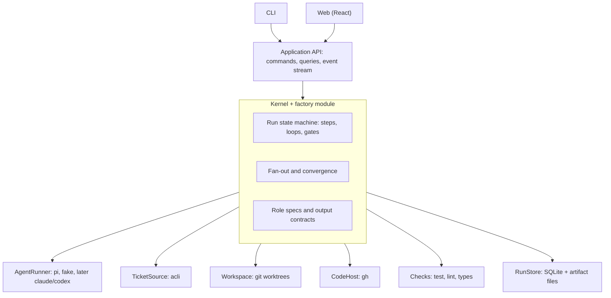
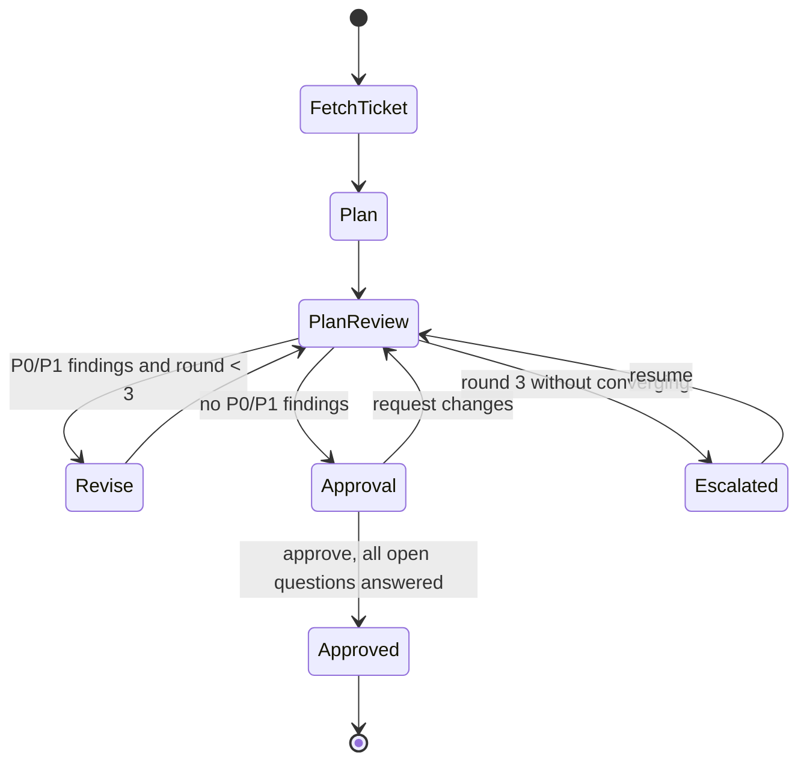

# Payo engine design

Status: agreed design, not implemented. It turns the [agentic factory](agentic-factory.md) flow into an engine and interfaces, as the first workflow module of the [local agent workbench](high-level-architecture.md). Where this document and the architecture document differ on near-term choices, this one wins; the architecture document still describes the long-term shape.

## Decisions

| Topic | Decision |
|---|---|
| Location | `payo/` in agentic-hub: a pnpm workspace beside `skills/`. Payo is the platform; the factory is its first module. |
| Process model | `payo serve` runs one local host process that owns the engine. CLI and web are thin clients over HTTP and SSE. The engine is a plain library, so tests drive it without a server. |
| Language and runtime | TypeScript on Node 24 LTS, with native type stripping and `node:sqlite`. No Python in the engine. The Python skill installer stays as it is. |
| Tooling | pnpm workspaces, Biome (lint and format), TS strict with `tsc --noEmit`, Vitest, Zod. |
| UI | Vite + React SPA (`apps/web`), TanStack Query, SSE for live updates. CLI from day one. No TUI. The plan is edited in your own editor, not in the browser. |
| Agent questions | No mid-step conversation in v1. Agents return open questions; the engine gates on them. Implementation never starts until every open question has your answer or explanation. |
| Durability | An append-only event log in SQLite is the source of truth; state is derived from it. |
| Observability | Normalised events streamed live, raw harness logs kept, IDs threaded everywhere. No OpenTelemetry until there is a consumer. |

## Layout

```
payo/
  packages/
    kernel/        runs, steps, attempts, event log, gates, artifacts, fan-out, ports
    contracts/     zod schemas: API, events, agent output contracts
  modules/
    factory/       ticket → PRs: state machine, role specs, convergence rules
    (later)        pr-review/, incident/, evaluation/
  adapters/
    runner-pi/  runner-fake/  (later runner-claude/, runner-codex/)
    jira-acli/  git/  gh/  store-sqlite/
  apps/
    server/        the only composition root; HTTP + SSE; `payo serve`
    cli/           thin client: `payo start ABC-123`, `payo approve`, …
    web/           React SPA, shared across modules
```

Dependency rules:

- `kernel` imports only `contracts`. It never imports a module or an adapter.
- Modules import `kernel` and `contracts`, never another module or an adapter.
- Adapters implement kernel ports. Only `apps/server` wires them in.
- `contracts` imports no other `@payo` package.
- Adapters import only `kernel` and `contracts`, never another adapter or module.
- `apps/cli` is a thin client and imports only `contracts`.
- Every layer, including `apps/server`, is barred from relative imports into another package; packages refer to each other by their `@payo` name.
- The rules are enforced by package dependencies, and by Biome restricted imports where packages alone are not enough.

The kernel holds only what the factory needs and any workflow would reuse. Routing, the model gateway, profiling and the module registry stay in the architecture document until a second module needs them. `tools/swarm-viewer` stays until the Payo web UI covers it.

## Ownership

The engine owns the flow, an agent owns one step, and the human talks to the engine, never directly to an agent.



- **Harness and model are adapter details.** The model is a per-role parameter in configuration.
- **The engine owns fan-out.** The audit swarm, now in `pi/workflows/swarm.js`, becomes engine logic that calls `AgentRunner` in parallel. It runs on any harness and is observable the same way everywhere, at the cost of pi-subagents' async and resume.
- **The engine decides when a loop ends**, from structured output, never from an agent's opinion.

## Ports

Design-level sketches. Exact types live in `contracts` and `kernel`.

```ts
interface AgentRunner {
  // One bounded agent session. Events stream while it runs; the result arrives at the end.
  run(spec: AgentSpec, signal: AbortSignal): AsyncIterable<AgentEvent>; // last event: { type: "result", … }
}

interface AgentSpec {
  role: string;                 // e.g. "planner", "plan-reviewer:architecture"
  instructions: string;         // rendered role spec
  cwd: string;                  // worktree path
  tools: "read-only" | "write"; // adapter maps this to native flags; unavailable if it cannot enforce it
  model: string | null;         // null: harness default, recorded as harness-owned
  limits: { timeoutMs: number };
  outputSchema: string;         // contract id the final JSON envelope must satisfy
}

interface TicketSource { get(key: string): Promise<Ticket>; }
interface Workspace   { create(runId: string, repo: string, base: string): Promise<string>; remove(path: string): Promise<void>; }
interface CodeHost    { openDraftPr(input: PrInput): Promise<PrRef>; findPr(branch: string): Promise<PrRef | null>; }
interface Checks      { run(cwd: string): Promise<CheckResult[]>; }
interface RunStore {
  append(runId: string, events: RunEvent[], expectedSeq: number): Promise<void>; // optimistic concurrency
  read(runId: string, fromSeq?: number): Promise<RunEvent[]>;
  putArtifact(content: Buffer, meta: ArtifactMeta): Promise<ArtifactRef>;      // immutable, hashed
}
```

`AgentEvent` is a normalised union: `started`, `message`, `tool_call`, `tool_result`, `usage`, `result`, `error`. Each adapter also keeps its native log as an artifact. The Pi adapter spawns `pi --mode json` with `--tools`, `--model` and a per-attempt `--session-dir`, and reads stdout as strict LF-split JSONL. It passes `--no-context-files --no-extensions --no-skills --no-prompt-templates --no-mcp` so the developer's global Pi setup (AGENTS.md, subagents) never leaks into a step, and loads only what the role needs with `--skill`. The model provider is Enterprise Claude through Pi's built-in `anthropic` OAuth login, which works with these flags. Pi reports tokens and an API-equivalent cost; the engine records that cost as an estimate, not as billing.

## Role specs

Skills define how each agent behaves. They were written for interactive chat, so the factory splits them:

| Part of the skill | Becomes |
|---|---|
| How to think: lenses, severities, test-first, plan format | Instructions, by referencing the skill file |
| Talking to the user: wait for a reply, ask what to address | Engine gates |
| Prose output | An output contract: a final JSON envelope validated by Zod |

A role spec references `skills/<name>/SKILL.md` by a path relative to the repo, adds factory overrides ("no user interaction; finish with this JSON envelope"), and records the skill's git SHA on every attempt. Fork a skill only when the overrides start fighting its text.

Invalid output is retried once with the validation error, then escalated.

## Records

| Record | Purpose |
|---|---|
| Run | One ticket: repo, base branch, effective configuration, current state |
| Step | A named stage: `plan`, `plan-review` round N, `approval` gate, … |
| Attempt | One execution of a step: runner, model, role spec and skill SHA, input artifact hashes, usage, outcome |
| Event | Append-only, ordered per run. The source of truth |
| Artifact | Immutable, content-hashed: ticket snapshot, plan versions, reviews, verified findings, diffs, raw harness logs |
| Gate | A pending human decision: kind, what it blocks, allowed commands |

Data lives in `~/.payo/`: `payo.db` and `artifacts/`. Plans live there, not in the target repo; only lasting outputs such as docs and ADRs are committed. Worktrees live in `~/.payo/worktrees/<run>/`.

Usage and cost stay `unknown` when a harness does not report them, never `0`.

## Durability rules

- State is derived from events. Restarting the server rebuilds it.
- On restart, attempts that were running become `interrupted` and raise a gate. Nothing is replayed automatically.
- External effects (push, PR creation) record an intent event before acting and an outcome event after. An intent without an outcome is reconciled against GitHub before any retry.
- One writer per run, enforced by `expectedSeq` on append.

## Factory flow, slice 1



- **Plan:** a planner adapted from `create-plan`. Output: a plan markdown artifact, a PR strategy (always present), and `openQuestions[]`.
- **Plan review:** fan-out of `review-plan` lenses, then a verifier, as the audit swarm does today. Output: verified findings with severity and classification.
- **Convergence:** the loop stops when no verified P0/P1 finding remains. It escalates after round 3.
- **Approval:** you edit the plan file in your editor, then `approve`. Approval is rejected while any open question lacks an answer. Answers are written back into the plan. The diff between the agent's last plan version and the approved version is recorded as a quality metric.

Later slices add implementation, checks and implementation review per PR, then draft PRs and the human PR review gate, then the web UI.

## Not decided yet

- Claude Code and Codex (OpenAI) runner adapters: how far their event and usage formats fit `AgentEvent`.
- Whether parallel Pi runners sharing one OAuth login race when the token refreshes.
- Later, not v1: Ollama Cloud as a model provider through Pi's `models.json`. Open: whether its models follow the final JSON envelope reliably, and whether it reports usage and cost (otherwise `unknown`).
- Whether Biome's restricted-import rules are enough to enforce the dependency rules, or if a dependency checker is needed.
- How the web UI authenticates to the loopback server (origin checks plus a local token are the expected baseline).
