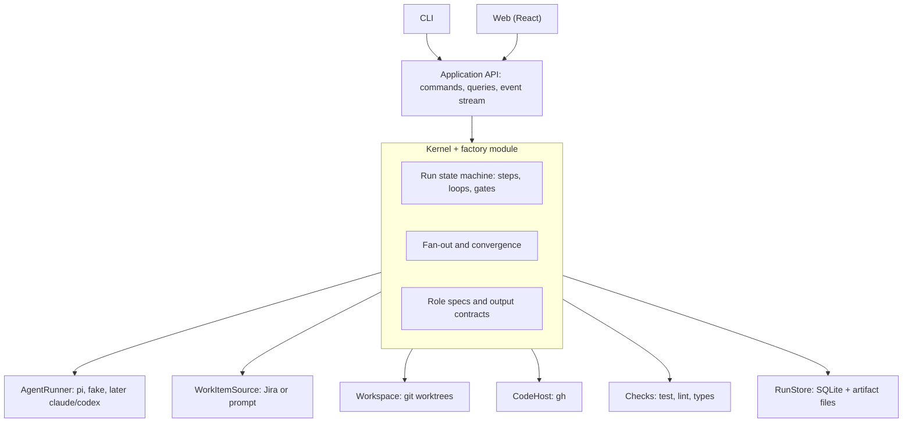
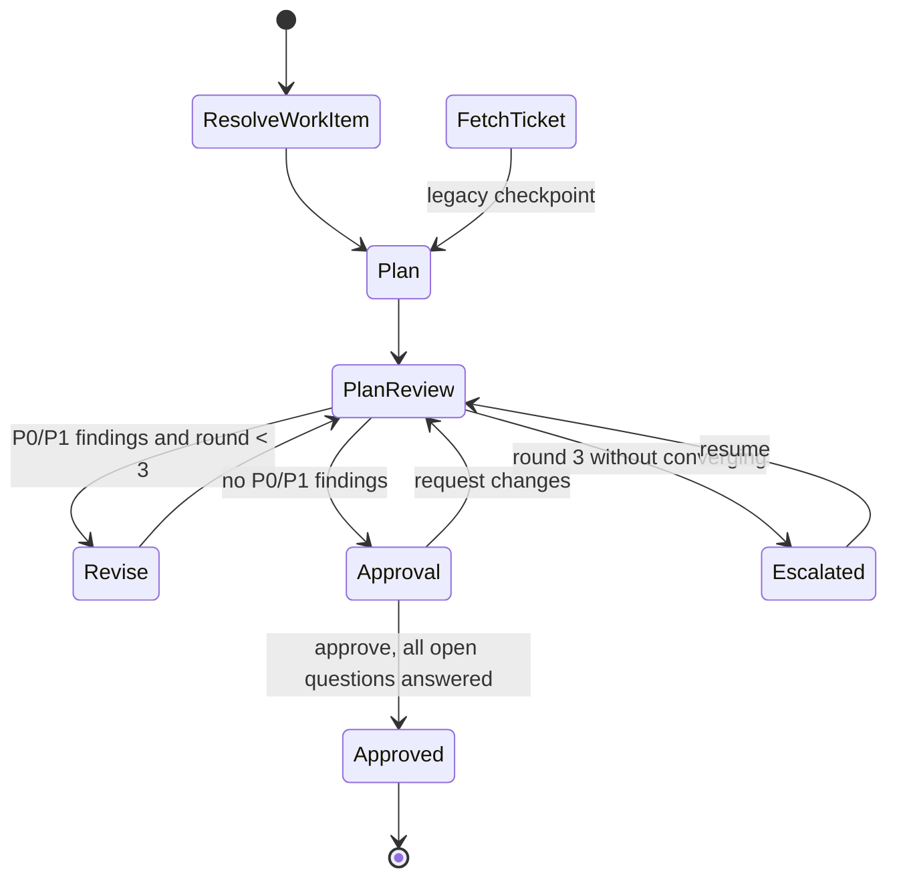

# Payo engine design

Status: agreed design and implementation snapshot. Real Jira, Git, Pi, checks,
and SQLite adapters are wired into the server, and the React web UI is
implemented. The factory plans and reviews work, then waits for explicit human
approval. A separate linked execution run can sequentially implement every
phase of one selected PR unit, run checks and mandatory review, perform bounded
repairs, and leave a reviewed local branch. It does not push or create PRs. Use
the [usage guide](usage.md) for supported behavior and the
[roadmap](implementation-roadmap.md) for planning status. It turns the [agentic factory](agentic-factory.md) vision into the first
workflow module of the [local agent workbench](high-level-architecture.md). Where
near-term choices differ, this document wins; the architecture document remains
the long-term proposal.

## Decisions

| Topic | Decision |
|---|---|
| Location | `payo/` in agentic-hub: a pnpm workspace beside `skills/`. Payo is the platform; the factory is its first module. |
| Process model | `payo serve` runs one local host process that owns the engine. CLI and web are thin clients over HTTP and SSE. The engine is a plain library, so tests drive it without a server. |
| Language and runtime | TypeScript on Node 24 or newer, with native type stripping and `node:sqlite`. No Python in the engine. The Python skill installer stays as it is. |
| Tooling | pnpm workspaces, Biome (lint and format), TS strict with `tsc --noEmit`, Vitest, Zod. |
| UI | Implemented Vite + React SPA (`apps/web`), TanStack Query, and SSE for live updates, alongside the CLI. No TUI. Direct plan edits use the user's editor; the browser supports review, prompt-driven revisions, version restore, and gate decisions, but has no freeform plan editor. |
| Agent questions | No mid-step conversation in v1. Agents return open questions; the engine gates on them. Implementation never starts until every open question has your answer or explanation. |
| Durability | An append-only event log in SQLite is the source of truth; state is derived from it. |
| Observability | Normalised events streamed live, raw harness logs kept, IDs threaded everywhere. No OpenTelemetry until there is a consumer. |

## Layout

```
payo/
  packages/
    kernel/        runs, steps, attempts, event log, gates, artifacts, fan-out, ports
    contracts/     Zod schemas: API, events, agent output contracts
    config/        shared TOML configuration and precedence
  modules/
    factory/       planning plus approved-plan phase execution and review
    (later)        pr-review/, incident/, evaluation/
  adapters/
    runner-pi/  runner-fake/  (later runner-claude/, runner-codex/)
    jira-acli/  git/  checks-process/  store-sqlite/  (later gh/)
  apps/
    server/        the only composition root; HTTP + SSE; `payo serve`
    cli/           thin client: `payo start ABC-123`, `payo start --prompt …`, `payo approve`, …
    web/           React SPA, shared across modules
```

Dependency rules:

- `kernel` imports only `contracts`. It never imports a module or an adapter.
- Modules import `kernel` and `contracts`, never another module or an adapter.
- Adapters implement kernel ports. Only `apps/server` wires them in.
- `contracts` imports no other `@payo` package.
- Adapters import only `kernel` and `contracts`, never another adapter or module.
- `apps/cli` is a thin client and imports `contracts`, plus `config` only for local bootstrap settings; it never imports the server, modules or adapters.
- Every layer, including `apps/server`, is barred from relative imports into another package; packages refer to each other by their `@payo` name.
- The rules are enforced by package dependencies, and by Biome restricted imports where packages alone are not enough.

The kernel holds only what the factory needs and any workflow would reuse. Routing, the model gateway, profiling and the module registry stay in the architecture document until a second module needs them. The Payo web UI is the supported dashboard for Payo runs; independent Pi swarms are outside its scope.

The current code implements `AgentRunner`, `WorkItemSource`, planning
`Workspace`, execution-only `ExecutionWorkspace`, `Checks`, and `RunStore` in
`packages/kernel`, with real adapters under `adapters/`. GitHub `CodeHost`
operations remain outside this slice.

Inside `modules/factory/src`, `domain/` holds pure planning/execution rules,
`planning/` and `execution/` own their lifecycle flows, and `infrastructure/plans.ts`
owns mutable plan-file access. The server's `run-application.ts` coordinates
commands and queries; `http.ts` handles transport and `composition.ts` wires
dependencies. Package and factory boundary tests enforce these divisions.

## Ownership

The engine owns the flow, an agent owns one fresh step/session, and the human
talks to the engine, never directly to an agent. The approved planning run is
terminal; a linked execution run owns implementation and verification progress.



- **Harness and model are adapter details.** The model is a per-role parameter in configuration.
- **The engine owns fan-out.** The audit swarm, now in `pi/workflows/swarm.js`, becomes engine logic that calls `AgentRunner` in parallel. It runs on any harness and is observable the same way everywhere, at the cost of pi-subagents' async and resume.
- **The engine decides when a loop ends**, from structured output, never from an agent's opinion.

## Ports

Design-level sketches. Exact types live in `contracts` and `kernel`.

```ts
interface AgentRunner {
  // One bounded agent session. Events stream while it runs; the result arrives at the end.
  run(spec: AgentSpec, signal: AbortSignal): AsyncIterable<AgentEvent>; // last event: { type: "result", … }
}

interface AgentSpec {
  role: string;                 // e.g. "planner", "plan-reviewer:architecture"
  instructions: string;         // rendered role spec
  cwd: string;                  // worktree path
  tools: "read-only" | "write"; // adapter maps this to native flags; unavailable if it cannot enforce it
  model: string | null;         // null: harness default, recorded as harness-owned
  limits: { timeoutMs: number };
  outputSchema: string;         // contract id the final JSON envelope must satisfy
}

type WorkItemRequest =
  | { source: "jira"; key: string }
  | { source: "prompt"; text: string };
interface WorkItemSource { resolve(request: WorkItemRequest): Promise<WorkItem>; }
interface WorkItem {
  origin: { source: "jira"; key: string; url: string | null } | { source: "prompt" };
  title: string;
  description: string;
}
interface Workspace   { create(runId: string, repo: string, base: string): Promise<string>; remove(path: string): Promise<void>; }
interface CodeHost    { openDraftPr(input: PrInput): Promise<PrRef>; findPr(branch: string): Promise<PrRef | null>; }
interface Checks      { run(cwd: string): Promise<CheckResult[]>; }
interface RunStore {
  append(runId: string, events: RunEvent[], expectedSeq: number): Promise<void>; // optimistic concurrency
  read(runId: string, fromSeq?: number): Promise<RunEvent[]>;
  putArtifact(content: Buffer, meta: ArtifactMeta): Promise<ArtifactRef>;      // immutable, hashed
}
```

`AgentEvent` is a normalised union: `started`, `message`, `tool_call`, `tool_result`, `usage`, `result`, `error`. Each adapter also keeps its native log as an artifact. The Pi adapter spawns `pi --mode json` with `--tools`, `--model` and a per-attempt `--session-dir`, and reads stdout as strict LF-split JSONL. It passes `--no-context-files --no-extensions --no-skills --no-prompt-templates --no-mcp` so the developer's global Pi setup (AGENTS.md, subagents) never leaks into a step. The role text is passed as the prompt from the factory's snapshot; `--skill` is intentionally not used so a run cannot drift from the recorded skill SHA. The child runs with `cwd` set to the run worktree and stdin ignored, so it inspects the right tree and does not wait for input. Raw JSONL is stored as an `agent-raw-log` artifact. Provider/model selection is configurable per role; Pi owns the corresponding authentication and provider setup. Pi reports tokens and an API-equivalent cost; the engine records that cost as an estimate, not as billing.

## Role specs

Skills define how each agent behaves. They were written for interactive chat, so the factory splits them:

| Part of the skill | Becomes |
|---|---|
| How to think: lenses, severities, test-first, plan format | Instructions, by referencing the skill file |
| Talking to the user: wait for a reply, ask what to address | Engine gates |
| Prose output | An output contract: a final JSON envelope validated by Zod |

A role spec references `skills/<name>/SKILL.md` by a path relative to the repo, adds factory overrides ("no user interaction; finish with this JSON envelope"), and records the skill's git SHA on every attempt. Fork a skill only when the overrides start fighting its text.

Invalid output is retried once with the validation error, then escalated.

## Records

| Record | Purpose |
|---|---|
| Run | One planning or linked execution lifecycle: repo, pinned/base reference, effective configuration, current state |
| Step | A named stage: `plan`, `plan-review` round N, `approval` gate, … |
| Attempt | One execution of a step: runner, model, role spec and skill SHA, input artifact hashes, usage, outcome |
| Event | Append-only, ordered per run. The source of truth |
| Artifact | Immutable, content-hashed: work-item snapshot, approved plan, execution manifest, phase receipts, checks/reviews, diffs, raw harness logs |
| Gate | A pending human decision: kind, what it blocks, allowed commands |

By default, data lives in `~/.payo/`: `payo.db` and `artifacts/`; `[paths].data_dir` or `PAYO_DATA_DIR` can select another absolute path. Prompt request text is stored as a `factory-work-item-request-v1` artifact under the resolved data directory; `run.created.config` contains only its reference, not the original plaintext. Agents may echo the prompt in attempt events, which authenticated event consumers can read, so this is not a confidentiality boundary. Plans live there, not in the target repo. Planning worktrees and execution worktrees live under `~/.payo/worktrees/<run>/`; an execution retains its local `payo/<execution-id>` branch.

Usage is a replacement snapshot for the whole attempt, emitted before the terminal event; adapters accumulate native per-call deltas first. Optional `costDetails` holds cumulative subtotals grouped by `(currency, basis)` plus a `complete` flag. A settled result or native error can keep the adapter's completeness; cancellation, timeouts, interruption, thrown validation, or a stream that ends without a result make the money incomplete. A missing report keeps earlier known subtotals; it never becomes zero.

The cost tree is work → runs → steps → attempts, derived from attempts rather than persisted as parent totals. `attempts` counts every started attempt, including failed and retried work. Coverage is `complete` when every included attempt has complete qualified amounts, `partial` when known subtotals accompany incomplete attempts, and `unknown` when nothing usable was reported. Legacy records without `costDetails` remain readable, but their scalar cost has no currency or basis and contributes no qualified total. `AttemptRecord.model` records the requested model, not billing provenance, and reported cost is not an invoice guarantee.

`projectRunCosts` (kernel) projects one run log; `readWorkCosts` (factory) combines a planning run with every stored execution child. Both are read-time views: newly created children appear on the next query, and each run reports the `asOfSeq` it included. Discovery reads logs without recovering, scheduling, or reading artifacts.

## Durability rules

- State is derived from events and immutable artifacts. Restarting the server rebuilds it; execution startup creates a gate rather than scheduling work.
- Interrupted writers preserve the branch/worktree and reconcile through a fresh context. Checks and reviews are rerun against the current snapshot; accepted receipts are never replayed.
- Engine-owned local commits persist intent (expected parent/tree/trailer) before acting, then reconcile a matching commit after a crash. Unexpected history remains gated.
- One writer per execution at a time; no review or check overlaps a writer. Optimistic append protects event progress, while workspace fingerprints bind evidence to a tree.
- Execution worktrees are retained on success and failure. Payo does not silently force-remove them; the operator owns cleanup after active child processes stop.

## Factory planning flow



- **Plan:** a planner adapted from `create-plan`. Output: a plan markdown artifact, a PR strategy (always present), and `openQuestions[]`.
- **Plan review:** fan-out of `review-plan` lenses, then a verifier, as the audit swarm does today. Output: verified findings with severity and classification.
- **Convergence:** the loop stops when no verified P0/P1 finding remains. It escalates after round 3.
- **Approval:** you edit the plan file in your editor, then `approve`. Approval is rejected while any open question lacks an answer. Answers are written back into the plan. The diff between the agent's last plan version and the approved version is recorded as a quality metric.

## Approved-plan execution

`payo implement <approved-run-id> --pr <pr-id>` accepts exactly one selected
PR unit and creates a separate run. The approved plan artifact—not a mutable
working file—is authoritative. A read-only preparer maps strategy phases to
validated exact excerpts and checks named prerequisites against the pinned base.
Each sequential phase gets a fresh implementer context with the full plan, its
phase input, repository instructions, and completed `PhaseReceipt` artifacts.
Checks are engine-owned and come from a nonempty operator-configured command
array; no shell command is read from model output.

A phase advances only after stable checks, all eight mandatory review lenses,
independent verification, and commit intent reconciliation. The phase receipt
and next-phase checkpoint append atomically. After the last receipt, Payo checks
and reviews the complete base-to-result PR diff. Final repairs use a separate
bounded validation budget and return only to final checks/review; they do not
re-enter the phase loop. Only clean final evidence ends the run as `reviewed`.

Every phase, repair, and review role is a fresh attempt/session. Immutable
artifacts and receipts carry context; transcripts do not. Restart creates a
recovery gate. Resume verifies branch/path/base/history and saved intent, then
reconciles interrupted writer changes or reruns check/review evidence. It never
replays accepted phases or silently recreates a missing dirty worktree. Operator
issue answers can clarify reported plan issues on resume without changing the
pinned plan; changed requirements need a corrected, newly approved source run.
The web correction action starts a new planning run and keeps the original
execution paused, with no automatic transfer of retained edits.

Writable Pi is a trusted local-code execution boundary, not a sandbox: a writer
can run code with the server user's permissions and inherited environment.
Worktree isolation is not filesystem, process, network, or credential
confinement. Payo retains branches/worktrees on all outcomes and owns local
phase/final commits; the operator owns cleanup after active work and child
processes have stopped. There are no push, GitHub, PR-creation, merge, or
automatic next-PR operations in this slice.

Jira requests are resolved by the Jira adapter; prompt requests resolve in the
server without invoking `acli`. A Jira login is required for Jira runs, not for
prompt-only server startup. `payo doctor` continues to report Jira readiness.
Linear is future work; there is no source registry or auto-detection.

## Not decided yet

- Claude Code and Codex (OpenAI) runner adapters: how far their event and usage formats fit `AgentEvent`.
- Whether parallel Pi runners sharing one OAuth login race when the token refreshes.
- Later, not v1: Ollama Cloud as a model provider through Pi's `models.json`. Open: whether its models follow the final JSON envelope reliably, and whether it reports usage and cost (otherwise `unknown`).
- Whether Biome's restricted-import rules are enough to enforce the dependency rules, or if a dependency checker is needed.
- Broader UI execution controls and independent Pi-swarm dashboards. The server and CLI implement Payo's local baseline: per-install bearer token, loopback-only binding, exact Origin allowlist, `payo token` handoff, session-memory token storage, and authenticated fetch-based SSE rather than token-bearing URLs or native `EventSource`.
