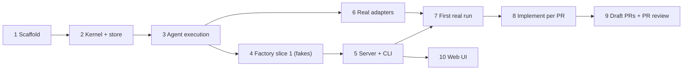

# Payo implementation roadmap

Status: proposed, for review. Breaks the [engine design](engine-design.md) into steps. Each step becomes its own plan through `create-plan`; this document fixes order, scope and exit criteria, not implementation detail.

## Shape

Build inside-out on fakes first, then swap in real adapters. Every step ends with something runnable and tested. Slice 1 (ticket → approved plan) is steps 1–7; steps 8–10 are later slices, listed so slice 1 does not paint them into a corner.

Step 6 can run in parallel with steps 4–5 once step 3 has fixed the `AgentRunner` and `AgentEvent` contracts.

## Slice 1: ticket → approved plan

### 1. Workspace scaffold

**Goal:** an empty `payo/` workspace whose tooling enforces the dependency rules from day one.

- pnpm workspace with the package layout from the design (`packages/`, `modules/factory`, `adapters/*`, `apps/*`), empty but wired.
- Node 24 (type stripping, `node:sqlite`), TS strict with `tsc --noEmit`, Biome, Vitest, Zod.
- One `pnpm check` that runs lint, types and tests. Add it to the repo README and as a Node 24 job in `.github/workflows/ci.yml`, beside the Python and swarm-viewer jobs.
- Dependency rules as package dependencies plus Biome restricted imports.

**Done when:** `pnpm check` passes. A deliberate `kernel → adapter` or `module → module` import fails it.
**Settles:** whether Biome is enough to enforce the rules, or a dependency checker is needed.

### 2. Kernel core and event store

**Goal:** durable runs whose state is derived from an append-only event log.

- `contracts`: Zod schemas for `RunEvent` and the records (Run, Step, Attempt, Gate, Artifact refs).
- `kernel`: `RunStore` port, a reducer from events to run state, gate raising and resolving, `expectedSeq` concurrency.
- Effective configuration (per-role model and limits, concurrency, data dir) resolved once and recorded on the Run, so a run never changes under a config edit.
- `store-sqlite`: `node:sqlite` event table in `~/.payo/payo.db`, immutable content-hashed artifacts in `~/.payo/artifacts/`. Data dir is configurable so tests use a temp dir.
- Restart: rebuild state from events; running attempts become `interrupted` and raise a gate.
- Usage and cost are typed as `number | "unknown"`, never defaulted to `0`.

**Done when:** tests cover append and read, a stale-`expectedSeq` rejection, rebuilding after reopen, and interrupted attempts after a simulated crash, against both an in-memory store and SQLite.
**Excludes:** intent/outcome reconciliation for external effects (step 9).

### 3. Agent execution

**Goal:** the kernel can run one agent step and a fan-out of them, observably, against a fake harness.

- `AgentRunner` port, `AgentSpec`, and the normalised `AgentEvent` union in `contracts`.
- `runner-fake`: scripted event streams and results, including invalid output, errors and hangs.
- Attempt lifecycle: record role, runner, model (or harness-owned), role spec and skill SHA, input artifact hashes, usage, outcome. Stream events into the run log.
- Output contracts: validate the final JSON envelope with Zod; retry once with the validation error, then escalate.
- Timeout and cancellation through `AbortSignal`.
- Fan-out helper: parallel attempts with a concurrency limit shared across runs, since every agent hits the same login; a failed child is reported as unchecked, not as clean.
- Every attempt starts with a clean context: its inputs are artifacts (ticket snapshot, plan version, findings), never a previous session. This answers the factory's context-management question.
- Role spec rendering: skill path relative to the repo, factory overrides, skill git SHA.

**Done when:** tests with `runner-fake` cover a valid run, invalid-then-valid, invalid twice → escalation, timeout, abort, and a fan-out with one failing child.

### 4. Factory module, slice 1, on fakes

**Goal:** the full slice 1 state machine running end to end in tests.

- `TicketSource` and `Workspace` ports with fakes.
- State machine: FetchTicket → Plan → PlanReview ⇄ Revise → Approval → Approved, with Escalated after round 3 and `resume`.
- Role specs and output contracts for planner (plan markdown, PR strategy, `openQuestions[]`), plan-review lenses, verifier, and reviser. Agents are read-only and return content in the envelope; the engine writes the artifacts.
- Fixed lenses are architecture, security, test coverage, code quality, correctness, simplicity and compatibility, from `skills/review-plan/references/lenses.md`. The fan-out → verifier shape and the verifier's classification rules come from `pi/workflows/swarm.js`, whose lenses are diff lenses and do not apply to a plan.
- Convergence: stop when no verified P0/P1 blocker remains; escalate at round 3. Explicit resume or request-changes starts a new cycle at round 1. Decided from structured output only. A failed lens blocks convergence: an unchecked lens is not a clean one.
- Escalation also when the reviser reports findings it cannot reconcile (the factory's "contradicting findings" case), not only at round 3.
- Plan versions: each agent version is an immutable artifact. The file you edit is a working copy under `~/.payo/runs/<run>/plan.md`; `approve` and `request-changes` snapshot it as a new version.
- Approval gate: `approve` is rejected while any open question lacks an answer; answers are written back into the plan; the agent-to-approved diff is recorded as a metric. `request-changes` snapshots the edited file and returns to PlanReview without a separate feedback message.
- Commands as plain library functions (`start`, `answer`, `approve`, `requestChanges`, `resume`) so step 5 only wraps them.

**Done when:** tests drive each transition in the design's state diagram with fakes, including approval blocked by an open question, a failed lens blocking convergence, and both escalation paths.
**Settles:** the exact JSON envelopes for each role; a fixed set of lenses is used in this slice.

### 5. Server and CLI

**Goal:** a human can drive a run from the terminal.

- `apps/server`: the only composition root. `payo serve`, HTTP commands and queries, SSE run event stream. Loopback only, with a local token and origin checks.
- `apps/cli`: `payo start ABC-123`, `status`, `logs -f`, `answer`, `approve`, `request-changes`, `resume`, and a way to open the plan file in `$EDITOR`.
- A client disconnect never cancels a run.
- Wired to fakes for now behind a dev flag, so the flow is usable before step 6 lands.

**Done when:** an end-to-end test starts the server on a temp data dir, runs a fake ticket to Approved through the CLI, and restarts the server mid-run without losing state.
**Settles:** web UI authentication baseline (reused by step 10).

### 6. Real adapters for slice 1

**Goal:** real harness, tickets and worktrees behind the ports.

- `runner-pi`: spawn `pi --mode json` with `--tools`, `--model`, per-attempt `--session-dir` and the `--no-*` isolation flags. The snapshotted role text is passed as the prompt; `--skill` is intentionally not used. Strict LF-split JSONL parsing, mapping to `AgentEvent`, raw log kept as an artifact, token and cost recorded as an estimate.
- `jira-acli`: `acli jira workitem view` to a `Ticket` snapshot artifact. Read-only.
- `git`: `Workspace` as worktrees in `~/.payo/worktrees/<run>/` detached at the resolved base commit. Removed on approve and retained while a run is resumable; escalated, cancelled and abandoned worktrees are a known cleanup gap deferred to a later slice.
- Run, step and attempt IDs passed to every adapter and kept in their logs.
- `payo doctor`: checks `pi`, `acli`, `git` and their logins, so an expired login fails fast instead of mid-run.
- Adapter tests against recorded fixtures (pi JSONL, acli JSON), plus opt-in live smoke tests that do not run in `pnpm check`.

**Done when:** fixture tests pass, a live smoke test runs one read-only Pi step in a worktree and returns a valid envelope, and a read-only step that tries to write is blocked.
**Settles:** whether parallel Pi runners sharing one OAuth login race on token refresh, and the workaround if they do (for example, a concurrency limit or a warm-up call).

### 7. First real run and tuning

**Goal:** slice 1 works on real tickets, and the role specs are good enough to keep.

- Tune the real adapters now that they are the default.
- Run 3–5 real tickets from ticket to approval. Tune role spec overrides from what goes wrong; fork a skill only if overrides fight it.
- Check the records answer the factory's metrics: plan edits at approval, review rounds, cost per ticket.
- Keep each ticket's snapshot, plan versions and approved plan as a small labelled corpus. It is the baseline for later evaluation, so role-spec changes are compared, not judged by feel.

**Done when:** those tickets reach Approved or a justified escalation, and every attempt is inspectable from `payo logs`.
**Output:** a short findings note feeding the step 8 plan.

## Later slices

Outline only. Each is planned when its predecessor is done, using what slice 1 taught.

### 8. Implementation per PR

`implement-plan` per PR in the PR strategy, in its own worktree. `Checks` port (test, lint, types) gating progress. Implementation review: plan-conformance lens plus the quality lenses, triage, fix, re-check, max 3 rounds, escalation on contradicting findings, failing checks, or a wrong plan. Ends with a branch ready for a draft PR.

### 9. Draft PRs and human PR review

`gh` `CodeHost` adapter. Intent and outcome events around push and PR creation, reconciled against GitHub before any retry. Human PR review gate: code changes go back to implementation review, plan changes back to approval. Record how much you change at PR review, the factory's second quality metric. Mark ready and mark phases done in the plan. A `next PR` gate: the next PR may start once the previous one is open, branching from it, but opens only after the previous one merges and it is rebased onto the base branch.

### 10. Web UI

`apps/web`: Vite, React, TanStack Query, SSE. Runs list, run timeline, attempt logs, gates with their allowed commands, review findings. No plan editing in the browser. Retire `tools/swarm-viewer` once it covers that view.

## Open for review

- **Other repositories.** The factory's planner researches "other repositories when defined or needed"; the design's Run has one repo. Proposal: one repo in slice 1, read-only extra repos later.
- **Architecture document.** That document's first slice was the PR reviewer, with a baseline comparison. The engine design moves the factory first, and its section on precedence says the engine design wins. The PR reviewer stays a later module.

## Not in this roadmap

Claude Code and Codex runners, Ollama Cloud, model routing, the gateway, profiling and other workflow modules. They stay in the [architecture document](high-level-architecture.md) until a step needs them.
