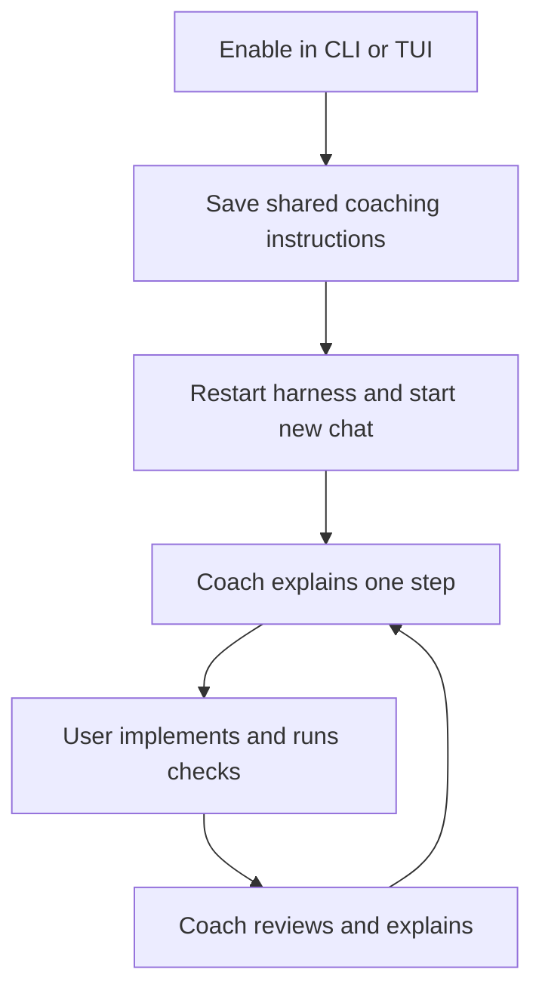

# Persistent coding coach toggle

**Proposal:** Add a coaching mode, off by default, that stays enabled across
chats in Claude Code, OpenCode, Pi, and Codex. One CLI or TUI control applies
to all four hosts in the current user's local environment; there are no
per-host or per-project switches.

## How it would work

The coach can inspect code, explain concepts, and offer increasingly specific
hints. It must wait for the user's attempt, without supplying implementation,
editing files, delegating implementation, or running tests, formatters, and
builds. Unrelated questions receive normal answers.

## What matters

- **Persistent guidance:** Store a marked section in each host's effective
  instruction file. One shared profile and controller serve both interfaces;
  files determine status, without a separate saved toggle. Existing skill
  commands stay independent.
- **Protect personal rules:** Preserve surrounding bytes and existing fallback
  behavior. Update shared physical files once; retain blocks another host still
  uses. Invalid markers or unresolved files produce errors. Defer cleanup of
  hidden blocks if any host's candidates cannot be validated.
- **Honest results:** Show every host's on/off/stale/error state. Partial updates
  remain in place; report failures and allow retry or disable. Status describes
  installed instructions, not proof that a model follows them.
- **Activation limits:** Both enabling and disabling require a harness restart
  and new chat. Coaching cannot enforce permissions or override higher-priority
  instructions. Asking to leave coaching within a chat does not change future
  chats. Unsupported OpenCode custom layouts must fail explicitly; support is
  limited to the environment visible to the hub.
- **Recovery:** Run `coach off` with the same environment and verify all hosts
  before reverting the feature. Removing its code alone leaves coaching
  instructions installed.

Build the controller first, then CLI controls, then TUI controls. Success needs
isolated filesystem and frontend tests, packaging verification, and live
on/off exercises on **all four hosts**, including persistence across chats.
Runtime acceptance remains pending, especially on OpenCode; a passing exercise
cannot guarantee future model compliance.

Details: [file safeguards](2026-10-12-coding-coach-toggle.md#own-a-marked-section-preserve-everything-around-it),
[delivery and tests](2026-10-12-coding-coach-toggle.md#implementation-phases),
[runtime exercise](2026-10-12-coding-coach-toggle.md#cross-harness-acceptance-exercise).

Source: [plan](2026-10-12-coding-coach-toggle.md), dated 2026-10-12, **draft**.
Summary created 2026-10-12; approval status unchanged.
