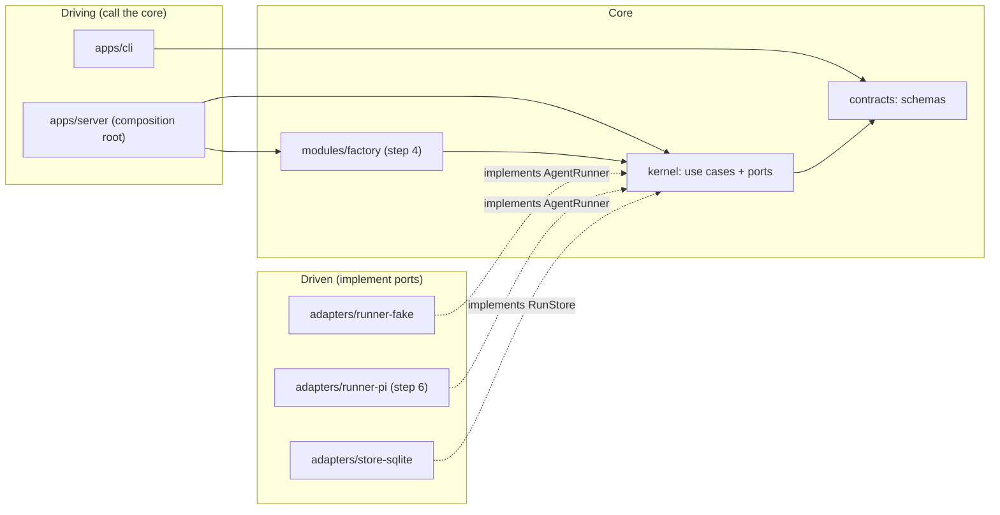

Roadmap step 3 of [docs/payo/implementation-roadmap.md](../../docs/payo/implementation-roadmap.md)
(section "3. Agent execution"). Goal: the kernel runs one agent step, and a fan-out of them, observably,
against a fake harness. Architecture: hexagonal (ports and adapters). The core owns the ports; adapters
implement them; only `apps/server` wires them.

Stacked on step 2 (`meta/plans/2026-10-30-payo-kernel-event-store.md`), which is implemented in the
working tree and not yet committed. Nothing is pushed or opened without an explicit ask.

## Current State

- Step 2 is implemented locally and green: `payo/` `pnpm check` passes, 140 tests.
- `attempt.started` and `attempt.finished` exist, with `AttemptOutcome` (`timed_out`, `cancelled`,
  `interrupted` included) and `StepOutcome` including `escalated`:
  `payo/packages/contracts/src/run.ts:46`, `:55`, `:80`, `:90`.
- `attempt.started.inputArtifacts` is `z.array(Id)`, not sha256 (`run.ts:87`; `AttemptRecord` at `run.ts:135`). Step 3 tightens both.
- The reducer requires a running step for a new attempt, and refuses `step.finished` while an
  attempt of that step runs: `payo/packages/kernel/src/state.ts:96` (`step.finished`), and requires a running
  step for `attempt.started` at `:108-110`.
- No agent event type or runner port exists. `payo/adapters/runner-fake/src/index.ts:1` and
  `payo/adapters/runner-pi/src/index.ts:1` are `export {};`.
- `payo/packages/contracts/src/run.ts` holds the primitives (`Json`, `Usage`, `UsageRecord`, `Sha256`,
  `ArtifactRef`, `Id`) and the event schemas together. Step 3 adds a schema that depends on
  `AgentEvent`, so the primitives move out to avoid an import cycle (Phase 1).
- Dependency rules are enforced by `payo/biome.json`: kernel imports only `@payo/contracts`; adapters
  import only `@payo/kernel` and `@payo/contracts`; adapter test files may import `@payo/kernel`.
  `payo/test/boundaries.test.ts:82` already blocks `modules/*` from importing `@payo/runner-fake`.
- Step 2 deferred the concurrency limiter to this step (its Deviations section).
- Pi's JSON stream (`pi docs/json.md`, "Event sequence") does not end at `agent_end`: Pi may
  auto-retry after it. The real end is `agent_settled`. `message_update` carries deltas, and its
  `usage` is cumulative per response. The contract below is written so the Pi adapter in step 6 maps
  onto it without guessing.

## Design Decisions

**Hexagonal layout.**



- **Ports are defined by the core and live in `kernel`.** `AgentRunner` (new) joins `RunStore`
  (step 2). The roadmap wording "port in `contracts`" is replaced: contracts holds schemas and pure parsing
  helpers only, with no I/O.
  Reason: the CLI imports contracts and must not see runner types; adapters depend on the core, never
  the reverse.
- **Data lives in `contracts`.** `AgentSpec`, `AgentEvent` and the `attempt.event` body are Zod schemas,
  since they are validated and persisted. `OutputValidator` is a function type and `jsonEnvelope` a pure
  parser over a schema. Both live here because they are the only parser of persisted output.
- **Use cases live in `kernel`.** `runAgentStep` is a core use case. It knows ports and schemas, never a
  concrete harness, git, or Jira.
- **Adapters never import each other or modules.** `runner-fake` is used by adapter tests. Modules
  (step 4) test against the port with a small inline stub. Only `apps/server` (step 5) wires
  `runner-fake` or `runner-pi` into a run.

**Agent events are persisted in the run log (roadmap decision 1, option a).** Each normalised
`AgentEvent` is written as an `attempt.event` row as it arrives, so `payo logs -f` and replay work.
Message text is stored whole, capped at 262144 characters per field (see Risks). There are no streaming
deltas in the union. Tool events carry `name` and `ok` only, never full arguments or output. Persisted text
is not redacted.

**`AgentEvent` union (`contracts/src/agent.ts`).**

| Event | Fields | Meaning |
|---|---|---|
| `started` | `model: string \| null` | The model the harness actually used, when it reports one. |
| `message` | `text` | A final assistant message. Written once per message, never a delta. |
| `tool_call` | `callId`, `name` | A tool started. |
| `tool_result` | `callId`, `name`, `ok: boolean` | A tool ended. |
| `usage` | `usage: UsageRecord` | Attempt-to-date totals. Cumulative: the last one wins; the kernel does not sum them. |
| `result` | `text` | The final output text. Terminal: the runner emits it at most once, then ends. |
| `error` | `message` | The runner failed before a result. Terminal. |

Pi mapping for step 6, decided here so both sides agree: `result` comes from the final assistant
`message_end`, emitted once at `agent_settled`, not at `agent_end`.

**Runner contract (`kernel/src/agent.ts`).** `AgentRunner.run(spec, signal)` returns an
`AsyncIterable<AgentEvent>`. The kernel treats `result` and `error` as terminal and stops reading
after either. The kernel never relies on the runner honouring `signal`: it races each `next()` against
the abort, so a runner that ignores abort still lets the attempt end on time.

**Input and output contracts.**
- `AgentSpec.outputContract` is an id, recorded for traceability. The caller passes the matching
  validator, `OutputValidator = (text: string) => EnvelopeCheck`, into the use case. `jsonEnvelope(schema)`
  in `contracts` builds one from a Zod schema. The factory's registry of ids to validators arrives in
  step 4. Step 3 tests pass a validator directly.
- The validator is the only place output is parsed. The kernel records the validation error text.

**Retry and escalation (roadmap decision 2).**
- Invalid output (a `result` arrived but the validator rejected it): one retry, as a new attempt in the
  same step, with a fresh session. The rejected output and the validation error are stored as
  artifacts (`kind: "agent-output"` and `kind: "validation-error"`, both `text/plain`) and passed as
  inputs named `previous-output` and `validation-error`. The retry instructions gain one fixed sentence
  (`RETRY_NOTE` in `agent-step.ts`) pointing at the error input.
- Invalid output on the second attempt: the rejected text is stored as an `agent-output` artifact, and its
  sha256 goes in the escalation gate's `reason`. Step `escalated`.
- Runner `error`, timeout, or a runner that ended with no result: no retry. Step `failed`.
- Cancellation: no retry and no gate. Step `failed`. Cancel is an operator action, not a fault. An open gate
  would block `run.ended` until a step 4 command resolves it.
- Every other returned failure, and every escalation, raises one gate before `step.finished`. An unexpected throw does not (Deviations, D1):
  `gateId: "escalation:<stepId>"`, `kind: "escalation"`, `allowedCommands: ["retry", "abandon"]`. The factory
  maps these in step 4.

**Attempt outcome mapping.**
Classified from the terminal reason the stream loop records (first one wins), never from signal state read
after the loop:
- Parent signal aborted → `cancelled`.
- Deadline (`AbortSignal.timeout(spec.timeoutMs)`) fired → `timed_out`.
- `error` event, or a stream that ends with no `result` → `failed`.
- `result` event: validator rejects → `failed`, with the validation error; accepts → `succeeded`, and the
  parsed value is returned.
- A valid `result` received before a deadline or abort still succeeds. A slow write cannot turn a finished
  output into `timed_out`.
- Any unexpected exception after `attempt.started` → `failed` with the message, then rethrow. A failed finish
  write leaves the attempt running until restart recovery.

**Usage.** `attempt.finished.usage` is the last `usage` event seen, or all-`"unknown"` when none arrived.
`0` is never a default.

**Role spec rendering (roadmap decision 3).** The kernel must not import the git adapter. The caller
passes the skill SHA, and `renderInstructions(skillPath, overrides)` is a pure function. It returns the
text `Follow the skill at <skillPath>.` followed by each override, separated by blank lines. Step 6 adds
the SHA lookup behind a port. If overrides grow beyond this, the function moves to the factory in step 4.

**Concurrency.** Two rules.
1. Every runner session holds a permit from a `Limiter`. The limiter is created once by the composition
   root and passed into each use case, so the limit is process-wide, shared across runs. Step 3 only
   creates it. Its setting comes from config in step 5.
2. Parallel steps on one run must not race for `expectedSeq`. A `RunLog` serialises writes for a run and
   keeps the folded state, so each write uses the latest seq. Without it, two concurrent steps in the
   same run would fail with `StaleSeqError`.

**Fan-out.** `fanOut(tasks)` runs every task and reports each one as `checked` (with its value) or
`unchecked` (with the error message). It never fails fast: siblings keep running. A child that threw is
never reported as clean. Its own attempts already passed through the limiter.

**Kernel generates no ids.** The use case takes `attemptIds: readonly [string, string]` from the caller.
Index 1 is used only on retry.

**Records durable on crash.** Step 2's recovery gates an attempt left running by a crash. Step 3 adds a
step case: a step left `running` with no running attempt and no open gate (the window between attempts, or
during the escalation batch) gets an `interrupted-step` gate, so a command can resolve it instead of the run
being stuck. Planned in Phase 4.

## Risks & Mitigations

- **Parallel steps race for seq.** Mitigation: `RunLog` serialises writes. A test runs concurrent steps
  on one run and expects consecutive seqs and no `StaleSeqError`.
- **A runner ignores the abort signal.** Mitigation: the kernel races every `next()` against the
  combined signal. A "deaf" fake test proves the attempt still ends at its deadline.
- **One writer per run per process.** `RunLog` is not resynced on `StaleSeqError`: a second writer to the same run leaves it stale, and every later write fails until reopened. Step 4 and 5 keep one RunLog per run. Recorded as a shortcut in `run-log.ts`.
- **Log growth and untrusted text.** Mitigation: `message.text`, `result.text` and `error.message` are capped
  at 262144 characters in the schema, a trust boundary. Adapters truncate before emitting. Shortcut:
  over-cap text is truncated, not moved to an artifact. Upgrade when a real message hits the cap: store the
  body as an artifact and keep its ref. Persisted text is not redacted, so anything the model echoes,
  secrets included, is readable from the run log.
- **Zod 4 API details** (`z.prettifyError`, `z.int`). Mitigation: Phase 1 checks them in a unit test
  before anything depends on them.
- **`AbortSignal.any` and `AbortSignal.timeout`.** `engines.node` is `>=24`, and both APIs exist there.
  Scenarios 6–8 exercise them indirectly.
- **Step 4 modules need a fake runner without importing adapters.** Mitigation: module tests use an
  inline `AgentRunner` stub, and `runner-fake` is reserved for adapter tests and step 5 wiring tests.
  Step 4's plan re-checks this.
- **Primitives move out of `run.ts`.** Mitigation: the move is mechanical. `run.test.ts` imports update
  in the same change, and the existing 140 tests pin the behaviour.

## Phase 1: Contracts

### Overview

Split the primitives out of `run.ts`, add the agent data schemas and the envelope validator, add the
`attempt.event` body, and tighten `attempt.started.inputArtifacts` to sha256 values.

### Changes

- **New `payo/packages/contracts/src/primitives.ts`.** Move, unchanged, from `run.ts`: `Json`, `RunConfig`
  (type and value), `Usage`, `UsageRecord`, `Sha256`, `ArtifactRef`, and `Id` (currently a local const
  `Id = z.string().min(1)`, exported here).
- **`payo/packages/contracts/src/run.ts`.** Import the primitives from `./primitives.ts`. Change
  `attempt.started.inputArtifacts` and `AttemptRecord.inputArtifacts` to `z.array(Sha256)`. Add to `RunEventBody`:
  ```ts
  z.object({
    type: z.literal("attempt.event"),
    attemptId: Id,
    event: AgentEvent,
  }),
  ```
  Keep `AttemptOutcome`, `StepOutcome`, `StepRecord`, `AttemptRecord`, `GateRecord` here.
- **New `payo/packages/contracts/src/agent.ts`.**
  - `AgentInput = z.object({ name: Id, ref: ArtifactRef })`.
  - `AgentSpec = z.object({ role: Id, instructions: z.string().min(1), roleSpecSha: Id.nullable(),
    cwd: z.string().min(1), tools: z.enum(["read-only", "write"]), model: Id.nullable(),
    timeoutMs: z.int().positive(), outputContract: Id, inputs: z.array(AgentInput) })`.
  - `AgentEvent`: `z.discriminatedUnion("type", [...])` with the seven variants in the table above.
    `usage` uses `UsageRecord`. `tool_result.ok` is `z.boolean()`. `message.text`, `result.text` and
    `error.message` are `z.string().max(262144)`. Tool `name` is `z.string().min(1).max(128)`.
  - `EnvelopeCheck = { ok: true; value: unknown } | { ok: false; error: string }`.
  - `OutputValidator = (text: string) => EnvelopeCheck`.
  - `jsonEnvelope(schema: z.ZodType): OutputValidator`. It runs `JSON.parse` (on a throw, returns
    `{ ok: false, error: "output is not JSON" }`), then `schema.safeParse`. On failure the error is
    `z.prettifyError(parsed.error)`.
  - Export the types with `z.infer`.
- **`payo/packages/contracts/src/index.ts`.** `export * from` `./primitives.ts`, `./run.ts`, `./agent.ts`.
- **Tests that move:** `payo/packages/contracts/src/run.test.ts` imports `Json`, `ArtifactRef`, `Usage`,
  `RunConfig` from `./primitives.ts`. Its `RunEventBody` cases stay in place.

### Tests (write first)

`payo/packages/contracts/src/agent.test.ts`:
- `AgentSpec` accepts a complete valid spec, and rejects `timeoutMs: 0`, an empty `instructions`, a
  `tools` value other than `"read-only" | "write"`, and an `inputs` entry with a non-sha256 `ref`.
- `AgentEvent` accepts one example of each of the seven variants. It rejects an unknown `type`,
  `tool_result` without `ok`, `usage` holding `"0"` (a string) rather than a `UsageRecord`, a `message`
  over 262144 characters, and a tool `name` over 128 characters.
- `jsonEnvelope`: returns `{ ok: true, value }` for JSON matching the schema; `{ ok: false }` with
  "not JSON" for `"not json"`; `{ ok: false }` naming the failing field for JSON that fails the schema.
  This also proves `z.prettifyError` exists in the pinned Zod.

`payo/packages/contracts/src/run.test.ts` (added cases):
- `RunEventBody` accepts `attempt.event` with a valid event.
- It rejects `attempt.event` with `event: { type: "nope" }`.
- It rejects `attempt.started` with `inputArtifacts: ["not-a-hash"]`.

### Success criteria

**Automated:**
- `cd payo && pnpm check` passes, including Biome import rules.
- `cd payo && pnpm vitest run packages/contracts` passes.

**Manual:** none.

### What we're NOT doing

- No runner port, no use case, no fake. Contracts only.
- No artifact spill for large text. The schema caps text (see Risks); adapters truncate before emitting.
- No registry of output contracts: step 4.

## Phase 2: Kernel port, reducer, fan-out, run log, instructions

### Overview

Add the `AgentRunner` port, the reducer case for `attempt.event`, the `Limiter`, `fanOut`, the `RunLog`
writer and `renderInstructions`. All are pure or port-only, and their tests need no adapter.

### Changes

- **New `payo/packages/kernel/src/agent.ts`.**
  ```ts
  import type { AgentEvent, AgentSpec } from "@payo/contracts";
  export interface AgentRunner {
    readonly id: string;
    run(spec: AgentSpec, signal: AbortSignal): AsyncIterable<AgentEvent>;
  }
  ```
  Doc comment (one line): the kernel treats `result` and `error` as terminal, and never relies on
  `signal` being honoured.
- **New `payo/packages/kernel/src/fanout.ts`.**
  - `interface Limiter { run<T>(task: () => Promise<T>): Promise<T> }`.
  - `createLimiter(max: number): Limiter`. FIFO queue. Throws `RangeError` unless `max` is a positive
    integer. A task's permit is released in `finally`.
  - `type ChildResult<T> = { status: "checked"; value: T } | { status: "unchecked"; reason: string }`.
  - `fanOut<T>(tasks: ReadonlyArray<() => Promise<T>>): Promise<ChildResult<T>[]>`. Runs all tasks
    with `Promise.allSettled`, in input order, each task wrapped as `async () => task()` so a synchronous throw
    is a rejection. Rejected children become `unchecked`, with
    `reason` set to the error message.
- **New `payo/packages/kernel/src/run-log.ts`.**
  - `interface RunLog { current(): RunState; write(bodies: RunEventBody[]): Promise<RunState> }`.
  - `openRunLog(store: RunStore, state: RunState): RunLog`. A promise chain serialises writes. Each
    write calls `commit(store, current, bodies)` and updates `current` only on success. A rejected
    write therefore leaves the state unchanged and the chain alive.
- **New `payo/packages/kernel/src/instructions.ts`.**
  `renderInstructions(skillPath: string, overrides: readonly string[]): string`. Returns
  `[`Follow the skill at ${skillPath}.`, ...overrides].join("\n\n")`.
- **`payo/packages/kernel/src/state.ts`.** Add `case "attempt.event":` to `reduce`. It calls
  `requireRunning(state.attempts, event.attemptId, "attempt")` and returns `next`. The state is
  otherwise unchanged. Events are kept in the log, not in `RunState`.
- **`payo/packages/kernel/src/index.ts`.** Add `export * from` for `./agent.ts`, `./fanout.ts`,
  `./run-log.ts`, `./instructions.ts`.

### Tests (write first)

`payo/packages/kernel/src/fanout.test.ts`:
- `createLimiter(2)` never runs more than two tasks at once (track the in-flight count; include a case
  with 5 tasks). Starts queued tasks in FIFO order.
- The limiter releases its permit when a task rejects, so the next task still runs.
- `createLimiter(0)` and `createLimiter(1.5)` throw `RangeError`.
- `fanOut`: three tasks, the middle one throws `new Error("boom")`. Result is
  `[checked, unchecked("boom"), checked]`, in input order. The other two complete. A task that throws
  synchronously is `unchecked` too.

`payo/packages/kernel/src/run-log.test.ts` (uses `createMemoryRunStore` and `testing.ts` builders):
- Ten concurrent `write` calls, each with one `artifact.recorded` or `step.started`, all succeed. The
  stored seqs are 1 to N with no gap, and no `StaleSeqError` is thrown.
- A `write` whose body fails the reducer rejects, and the next `write` still succeeds from the previous
  state.

`payo/packages/kernel/src/instructions.test.ts`:
- With no overrides, the result is only the path sentence.
- With two overrides, the result has the path sentence, then each override in order, separated by blank
  lines.

`payo/packages/kernel/src/state.test.ts` (added cases, using the existing `seqd` and `body` helpers):
- `attempt.event` on a running attempt leaves `steps`, `attempts` and `gates` equal to the prior state,
  and advances `lastSeq`.
- `attempt.event` on a finished attempt throws `/is not running/`.
- `attempt.event` for an unknown attempt throws `/unknown attempt/`.

### Success criteria

**Automated:**
- `cd payo && pnpm check` passes.
- `cd payo && pnpm vitest run packages/kernel` passes, including the new files.

**Manual:** none.

### What we're NOT doing

- No use case yet (`runAgentStep` is Phase 4).
- No `runner-fake` (Phase 3).
- No timeout or abort logic. That lives in the use case, where the attempt's deadline is known.
- No factory role specs.

## Phase 3: `runner-fake`

### Overview

A scripted `AgentRunner` adapter. It is the only fake in the step, used by adapter tests and later by
step 5 wiring tests. Modules never import it.

### Changes

- **`payo/adapters/runner-fake/src/index.ts`** (replaces `export {};`):
  ```ts
  export type FakeStep =
    | { kind: "emit"; event: AgentEvent }
    | { kind: "hang"; ignoreSignal?: boolean }
    | { kind: "throw"; message: string };

  export interface FakeRunner extends AgentRunner {
    readonly calls: readonly AgentSpec[];
  }

  export function createFakeRunner(scripts: readonly FakeStep[][], id = "fake"): FakeRunner;
  ```
  - `run(spec, signal)` pushes `spec` into `calls` synchronously, then returns an async iterable that
    plays `scripts[calls.length - 1]`. If there is no script for that session, it throws
    `Error("no script for session N")` on the first `next()`.
  - `emit` yields the event. `throw` throws the message. `hang` waits until `signal` aborts, then
    ends; if the signal is already aborted, it ends at once. `hang` with `ignoreSignal: true` never
    settles.
- `package.json` is unchanged: the runner depends on `@payo/kernel` and `@payo/contracts` already.

### Tests (write first)

`payo/adapters/runner-fake/src/index.test.ts`:
- Session 1 plays its script in order, and `calls` records the spec.
- Session 2 gets the second script. A third run, with only two scripts, rejects with
  "no script for session 3".
- A `hang` step ends when the signal aborts, and the stream finishes with no further events.
- A `throw` step rejects the `next()` call with its message.
- A `hang` with `ignoreSignal` is still pending after the signal aborts (a 20 ms `setTimeout` race
  resolves to `"pending"`).

### Success criteria

**Automated:**
- `cd payo && pnpm check` passes.
- `cd payo && pnpm vitest run adapters/runner-fake` passes.

**Manual:** none.

### What we're NOT doing

- No `runner-pi` (step 6).
- No tool enforcement: the fake records the `tools` value and does not check it.
- No re-export of the fake from `@payo/kernel`.

## Phase 4: Agent step use case and scenario tests

### Overview

`runAgentStep` in `kernel` runs one step: records it, runs up to two attempts with the retry rule,
raises the escalation gate when needed, and finishes the step. The scenario tests live in
`kernel`, driven by a scripted `AgentRunner` in the test file, so the core is verified by its own package.
`runner-fake` keeps only its Phase 3 unit tests. The tests are written first, against an
`agent-step.ts` that throws `not implemented`, so they fail for the right reason.

### Changes

- **New `payo/packages/kernel/src/agent-step.ts`.**
  ```ts
  export interface AgentDeps { store: RunStore; log: RunLog; limiter: Limiter }
  export interface StepInput {
    stepId: string;
    stepName: string;
    attemptIds: readonly [string, string];
    runner: AgentRunner;
    spec: AgentSpec;
    validate: OutputValidator;
    signal: AbortSignal;
  }
  export interface StepResult { outcome: StepOutcome; value?: unknown }
  export function runAgentStep(deps: AgentDeps, input: StepInput): Promise<StepResult>;
  ```
  Internal flow:
  1. `log.write([{ type: "step.started", stepId, name: stepName }])`.
  2. For attempt `n` in 0 and 1 (stop early when not retrying):
     - Run `executeAttempt` inside `deps.limiter.run`.
     - On success: write `step.finished{succeeded}`, return `{ outcome: "succeeded", value }`.
     - On a rejected output: store the rejected text as `agent-output` (`text/plain`) with
       `store.putArtifact`, and write its `artifact.recorded` with the failed attempt's id. If `n === 0`, also
       store the error as `validation-error`, write its `artifact.recorded`, build the retry spec with
       `instructions + RETRY_NOTE` and the two new inputs, and continue.
     - Otherwise: stop.
  3. After the loop, the outcome is `escalated` if the last attempt rejected output, `failed` if it was
     cancelled (no gate), and `failed` otherwise. Write one batch, gate first, so a partial write leaves a
     step that a command can resolve:
     - Escalations and failures other than cancel: `gate.raised{gateId: "escalation:<stepId>", stepId,
       kind: "escalation", allowedCommands: ["retry", "abandon"], reason}`, then `step.finished{outcome}`.
     - Cancel: `step.finished{failed}` only.
     `reason` is the validation error and the rejected output's sha256 for an escalation, and the attempt's
     error otherwise.
  4. Wrap steps 1–3 in try/catch. On an unexpected throw, best-effort write `step.finished{failed}`
     (ignore a failure of that write), then rethrow. A step left `running` blocks `run.ended`.

  `executeAttempt(deps, input)`:
  - Inside the limiter: if `input.signal` is already aborted, return `cancelled` at once, with no
    `attempt.started` and no runner call. Otherwise write `attempt.started{attemptId, stepId, role: spec.role, runner: runner.id,
    model: spec.model, roleSpecSha: spec.roleSpecSha, inputArtifacts: spec.inputs.map(i => i.ref.sha256)}`.
  - `deadline = AbortSignal.timeout(spec.timeoutMs)`. `combined = AbortSignal.any([input.signal, deadline])`.
  - Call `runner.run(spec, combined)[Symbol.asyncIterator]()`. Race each `next()` against one `stopped`
    promise, created before the loop, that settles when `combined` aborts; remove its listener in `finally`.
    For each event: write `attempt.event{attemptId, event}`. Track `usage` (last one), `result` text (first
    one), and `error` message (first one). Record the terminal reason, the first of: `result`, `error`,
    `aborted` (`input.signal` aborted when `combined` fires), `deadline` (otherwise), `ended` (stream ends
    with no result). Stop once the reason is set; call `iterator.return?.()` without awaiting it.
  - Classify from the recorded reason only, never from signal state read after the loop: `aborted` → `cancelled`;
    `deadline` → `timed_out`; `error` → `failed`; `ended` → `failed` ("runner ended without a result");
    `result` → `validate(text)`: rejects → `failed` with the error, marked as a rejected output; accepts →
    `succeeded`. A `result` or `error` recorded first wins over a later deadline or abort.
  - Write `attempt.finished{attemptId, outcome, usage: lastUsage ?? UNKNOWN_USAGE, error?}`.
  - Wrap the body: on an unexpected throw after `attempt.started`, try to write
    `attempt.finished{failed, error: message}`, ignore a failure of that write, then rethrow. A failed finish write leaves the attempt running until restart
    recovery.
  - Return `{ outcome, value?, rejected?: { text, error } }`. `UNKNOWN_USAGE` is all three fields
    `"unknown"`.
- **`payo/packages/kernel/src/run.ts`, `recover()`.** Also gate a step left `running` with no running attempt
  and no open gate for that step: `gate.raised{gateId: "interrupted-step:<stepId>:<lastSeq>", stepId, kind:
  "interrupted-step", allowedCommands: ["retry", "abandon"], reason: "step had no running attempt when the
  process stopped"}`. It is evaluated on the pre-batch state, so a step with a running attempt is handled by
  the existing attempt case. The step stays `running` until a command resolves the gate.
- **`payo/packages/kernel/package.json`.** Add `zod` as a devDependency. It is test-only: the scenario tests
  build `jsonEnvelope(z.object(...))`, and the kernel runtime does not import zod.
- **`payo/packages/kernel/src/index.ts`.** Export `./agent-step.ts`.

### Tests (write first)

`payo/packages/kernel/src/agent-step.test.ts`, with a scripted `AgentRunner` defined in the file. Each test
builds a store with
`createMemoryRunStore`, a `RunLog` opened on `startRun`, and a `createLimiter(4)`. It reads the log back
with `store.read` and uses the `fold` helper where it checks state. `validate` is
`jsonEnvelope(z.object({ verdict: z.literal("ok") }))`, and the valid result text is
`{"verdict":"ok"}`.

1. **Valid run.** One session: `started`, `message`, `usage`, `result(valid)`. Expect the step
   `succeeded`, `value` equal to `{ verdict: "ok" }`, one attempt `succeeded` with the usage
   as reported, `attempt.started` recording `roleSpecSha` and input hashes, and log order
   `step.started`, `attempt.started`, four `attempt.event`, `attempt.finished`, `step.finished`.
2. **Invalid, then valid.** Session 1 returns `result("not json")`; session 2 returns the valid
   result. Expect `succeeded`, attempt 1 `failed` with error "output is not JSON", two artifacts
   recorded with kinds `agent-output` and `validation-error`, and session 2's `calls[1].inputs` naming
   `previous-output` and `validation-error`. Its instructions end with `RETRY_NOTE`. No gate.
3. **Invalid twice.** Both sessions return invalid output. Expect step `escalated`, two attempts
   `failed`, one open gate `escalation:<stepId>` with `allowedCommands ["retry", "abandon"]` and a `reason` containing
   the sha256 of the second `agent-output` artifact, and
   `step.finished{escalated}` after the gate in the log.
4. **Runner error, no retry.** One session emits `error("boom")`. Expect step `failed`, one attempt,
   gate `escalation:<stepId>` open, and `error` "boom" on the attempt.
5. **Stream ends without a result.** Expect step `failed` with the "without a result" error and no retry.
6. **Timeout.** `timeoutMs: 20`, one session that hangs honouring the signal. Expect attempt
   `timed_out`, step `failed`, one attempt only.
7. **Timeout with a deaf runner.** As in 6, with `ignoreSignal: true`. Expect the step to finish in
   under 2 seconds, with attempt `timed_out`. This proves the race.
8. **Abort.** The parent `AbortController` aborts 10 ms in, while the runner hangs. Expect attempt
   `cancelled`, step `failed`, and no gate in the log.
9. **Fan-out with one failing child.** Three steps on the same run, under `fanOut`, each with its own
   runner. The middle step's validator throws `new Error("validator bug")`. Expect results
   `[checked, unchecked("validator bug"), checked]`. The log has no `StaleSeqError`. The failed
   child's attempt is recorded `failed` with that message, and no attempt remains `running`. The failed child's step is `failed`, not stranded `running`.
10. **Concurrency bound.** Launch five steps together through `fanOut`, each one attempt, with a `createLimiter(2)`. Wrap the runner
    so it counts in-flight sessions. Assert the maximum observed is exactly 2.
11. **Crash window** (kernel `run.test.ts`). A folded state with a running step, no running attempt and no
    gate. `recover()` returns the `interrupted-step:<stepId>:<lastSeq>` gate. A step with a running attempt yields only
    the attempt case, with no step gate.
12. **Result, then deadline during the write.** A store wrapper delays `append` past `timeoutMs`, and the
    runner emits a valid `result`. Expect attempt `succeeded`, step `succeeded`.
13. **Result, then abort during the write.** As in 12, but the parent aborts during the delayed write. Expect
    `succeeded`.
14. **Queued cancel.** `createLimiter(1)`. The first step holds the permit. Abort the second step's signal
    while it waits. Expect no `attempt.started` for it, an empty `calls` on its runner, step `failed`, and no
    gate.
15. **Usage.** (a) No `usage` event: all `"unknown"`. (b) Two `usage` events, then a timeout: the second
    values are recorded.

Also add to `payo/test/boundaries.test.ts`: one row showing that `packages/kernel/src/a.ts` importing
`@payo/runner-fake` is blocked. The existing kernel rule already covers it, so the row proves it rather
than assuming it.

### Success criteria

**Automated:**
- `cd payo && pnpm check` passes, with all fifteen scenarios green.
- `cd payo && pnpm vitest run packages/kernel/src/agent-step.test.ts` passes on its own.

**Manual:** none. A reviewer can read the event sequence for scenario 2 from the test output, if
they want to confirm the retry reads well.

### What we're NOT doing

- No runner-pi, no git, no tickets.
- No factory role specs or output registry (step 4).
- No `retry` or `abandon` command handling. The gate records the allowed commands only. Step 4 and step 5
  act on them.
- No persistence of `RunLog` state across restarts beyond what `openRun` already does.
- No timeout or abort handling for the whole step. Only per attempt.

## Deviations (planned, from the design decisions)

- **Port location.** The roadmap puts `AgentRunner` in `contracts`. This plan puts it in `kernel`, per
  the hexagonal layout. Record in the roadmap when merged.
- **Primitives moved** from `run.ts` to `primitives.ts`, to avoid an import cycle with `AgentEvent`.
- **Step 2 schema tightened:** `attempt.started.inputArtifacts` is sha256, not any id, and
  `AttemptRecord.inputArtifacts` follows. Reset any local store written by the uncommitted step 2:
  `store-sqlite` parses every row on read (`adapters/store-sqlite/src/index.ts:130`), so non-hash values
  would fail to open.
- **Recovery gains a step case** (`interrupted-step` gate), beyond the attempt-only recovery in step 2.
- **`RunLog` and `fanOut`** are added. The roadmap names "fan-out helper" but not the write serialisation,
  which concurrent steps need.
- **Escalation gate** is added to the step outcome, as the roadmap's escalation path requires.
- **Phases 1 and 2 implemented** (`pnpm check`: 185 tests). Deviations found during implementation:
  - The reducer's `attempt.event` case moved from Phase 2 into Phase 1, because `pnpm check` (the Phase 1 gate) fails without it: the exhaustive switch no longer compiles.
  - `AgentSpec.timeoutMs` is capped at `2147483647` (the timer ceiling), so a larger value cannot fire at once. Plan literal was `z.int().positive()`.
  - `fanOut` describes a non-Error rejection with `JSON.stringify`, falling back to `"non-Error rejection"`. `String(x)` throws on a null-prototype object and would reject the whole fan-out.
  - `RunLog.write` clones its `bodies` with `structuredClone` at call time, so a caller who mutates the array or its elements after the call cannot change what is committed. Non-cloneable input rejects.
- **Deferred from the round 1 audit** (not in phases 1–2): `runStoreContract` coverage for `attempt.event` and sha256 inputs (add with Phase 4); `AgentEvent` `Id` fields (`callId`, `started.model`) are uncapped, a trust boundary to cap when runner-pi emits them (step 6); `fanOut` and `RunLog` error paths for Phase 4 (`run-log` `.catch` marks a failed write as handled, so Phase 4 must await every write).

- **Phases 3–4 implemented** (`pnpm check`: 220 tests). Two audit rounds ran (7 lenses each, verifier-triaged). No blocker is open. Deviations found during implementation:
  - **D1, throws do not gate.** A runner that throws, a schema-invalid runner event, a validator bug or a failed store write rethrows to the caller, with the attempt and step `failed` and no escalation gate. Returned failures still gate. A gate would ask the operator to retry or abandon a bug. Pinned by tests.
  - **D2, gate on a finished step.** The escalation gate and `step.finished` are one batch, so `retry` and `abandon` target a finished step. Step 4 owns the finished-to-running transition that `retry` needs.
  - **`outputContract` is not recorded on `attempt.started`**, because the schema has no field for it. Step 4 adds it if traceability needs it.
  - **Runner events are parsed at receipt** with `AgentEvent`. A schema-invalid event fails the attempt and never reaches the log. `AgentSpec` is parsed at entry, before the first row.
  - **Each event yields to the event loop** (`setImmediate`), so a runner that never awaits cannot starve the deadline. Costs one macrotask per event.
  - **The deadline includes the `attempt.started` write**, because the timer starts before it. A slow write counts against `timeoutMs`.
  - **Recovery gate ids** are `interrupted-step:<stepId>:<lastSeq>`. The suffix stops a second crash in the same window from colliding with a resolved gate (`assertFresh`). The reducer reserves the `interrupted-step:<stepId>:` prefix to kind `interrupted-step`, as it does `interrupted:`.
  - **`describeReason` is public** through the kernel barrel. It also formats thrown errors: strings pass through, other non-Error values use `JSON.stringify`, and an unserialisable value gives `non-Error rejection`.
  - **Known limits (shortcuts, not fixed):** no cap on `attempt.event` rows per attempt (step 6 adds a budget; the parent sets its value). A queued step's cancel waits for its permit, because `Limiter` takes no signal (step 5). A deaf runner's session can outlive its permit, so the limiter bounds attempts, not live sessions. `attempt.finished.error` is uncapped, so a long validator error is stored whole; it cannot strand an attempt.
  - **Not tested:** a failed append on `attempt.finished`. Per the plan, the attempt stays `running` until restart recovery.
  - **Follow-up (contracts, step 4):** gate `kind` is an open string. A closed enum is safer.

## PR Strategy

One PR, stacked on step 2's PR B. Four phases, each leaving `pnpm check` green, so the PR can be read
phase by phase. Reverting the PR leaves step 2 intact.
