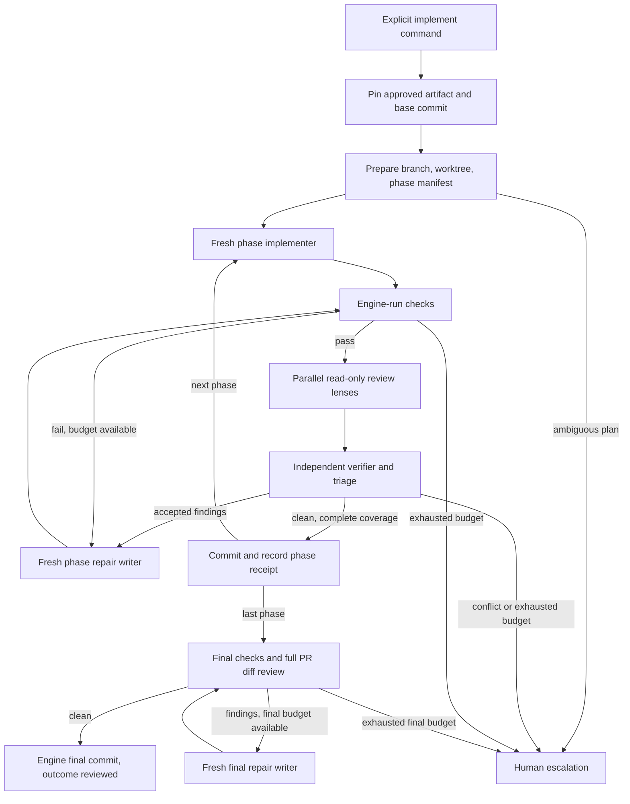

# Payo approved-plan execution

## Outcome and agreed scope

An explicit CLI command takes one PR unit from an approved plan, implements its
phases sequentially, runs checks and an implementation-review swarm, and leaves a
reviewed local branch. Every phase, review, verifier, and repair attempt starts in
a new agent context. Code and immutable artifacts carry progress between phases;
conversation history does not.

The user approved four implementation phases: execution contracts/lifecycle; one
phase end to end; review/repair; multiple phases/recovery. They explicitly require
principal-engineer-level attention to DDD, clean/onion architecture, design
patterns, SOLID, DRY, and general code quality. These apply from initial planning
and plan revision through plan review, implementation, and implementation review,
both to Payo itself and to the work it produces.

Scope includes contracts, kernel ports, factory orchestration, adapters, server
composition/API, CLI, tests, and usage documentation. No web implementation,
GitHub publication, PR readiness, merge/rebase automation, or automatic next-PR
execution. The result is a local branch and retained worktree, not a GitHub PR.

## Current State

References describe the working tree inspected on 2026-11-02, including existing
uncommitted changes; they are not a claim about HEAD.

- `payo/modules/factory/src/commands.ts:1000`: `approve` snapshots human edits;
  at lines 1051 and 1067 it removes the planning worktree and ends the run with
  outcome `approved`. Preserve that public behavior.
- `payo/packages/kernel/src/state.ts:52`: ended runs reject subsequent events.
  Reopening a planning run would also conflict with terminal SSE behavior in
  `payo/apps/cli/src/client.ts`. Use a linked execution run.
- `payo/packages/contracts/src/factory.ts:46`: plans contain markdown plus
  `prStrategy` entries with IDs, titles, and phase strings. Those phase strings
  are not executable phase records. Human markdown edits do not regenerate them.
- `payo/modules/factory/src/review.ts:27`: parallel lens agents feed a verifier;
  `state.ts:10` checks verdict coverage, unchecked lenses, and bounded convergence.
  Current convergence blocks on verified P0/P1 findings only.
- `payo/modules/factory/src/roles.ts:70`: all current factory roles are read-only;
  line 80 delegates agent scheduling and artifacts to the engine.
- `payo/modules/factory/src/roles.ts:7`: architecture and code-quality lenses are
  mandatory in the current plan-review fan-out, but their briefs only name broad
  concerns such as modularity and design principles. `role-sources.ts:6` gives
  planner/reviser no supporting resources and reviewer/verifier only the plan
  lens table. Detailed DDD, clean/onion, SOLID and DRY audit rubrics are not
  currently wired into planning role snapshots.
- `payo/packages/kernel/src/agent-step.ts:53`: `runAgentStep` owns attempt events,
  artifacts, timeout, and output validation. Its automatic output retry retains
  the original tool permissions; that is unsafe to reuse unchanged for writers.
- `payo/adapters/runner-pi/src/index.ts:47`: write mode already includes edit,
  write, and bash. Per-attempt session directories provide fresh contexts.
  The process inherits environment variables and uses `--no-approve`; worktree
  cwd is not a filesystem or process sandbox.
- `payo/packages/kernel/src/workspace.ts:6`: `Workspace` only creates and removes
  worktrees. `payo/adapters/git/src/index.ts` creates detached worktrees and removes
  them forcibly. Execution needs named branches, snapshots, and safe retention.
- `payo/apps/server/src/composition.ts:153`: the server injects dependencies and
  owns background work. The CLI remains an HTTP client.
- `payo/apps/server/src/role-sources.ts:6`: role sources and resources are loaded
  from Git and snapshotted. Extend this mechanism instead of relying on installed
  Pi extensions, automatic skills, or a developer's ambient configuration.
- `payo/tsconfig.json` excludes the web app, and `payo/vitest.config.ts` defines
  a `core` project. Core verification can run without implementing the web UI.

## Design Decisions

### Domain, ownership, and dependency direction

Keep the factory as the bounded context for planning and implementation. An
**execution run** implements one **PR unit** from one immutable **approved plan**.
A **phase** is an ordered implementation/check/review unit. A **repair round**
addresses verified findings or failed checks. A **phase receipt** records what
the engine actually accepted. These names must be consistent in contracts,
prompts, events, tests, and CLI output.

Do not introduce a generic workflow framework, module registry, DI container,
base service class, event bus, or additional bounded context. Use existing plain
functions and injected port objects. Extract cohesive execution code from the
large planning command surface into factory-local files; do not copy its whole
state machine or put factory policy in the kernel.

| Owner | Responsibility |
| --- | --- |
| `contracts` | Validated execution/API/artifact shapes; imports no Payo package |
| `kernel` | Generic attempts, events, storage, concurrency, outbound workspace/check contracts |
| `modules/factory` | Approved-plan selection, phase order, quality policy, roles, convergence, gates |
| Git/check/Pi adapters | Git operations, subprocess checks, bounded agent sessions |
| `apps/server` | Construct adapters, inject ports, accept/schedule commands, serve read models |
| `apps/cli` | Parse arguments, call API, render status/results; no Git or workflow policy |

Domain decisions depend on typed values and port results, never Git CLI output,
HTTP requests, SQLite rows, or Pi-specific records. Use functional code where
it expresses the rule clearly; DDD does not require classes for every record.
Introduce a pattern only to solve a present collaboration or invariant problem.

### Lifecycle and CLI contract

Proposed public commands (implemented by phases 2–4):

```text
payo implement <approved-run-id> --pr <pr-id> [--base <ref>]
payo status <execution-run-id>
payo logs <execution-run-id> -f
payo resume <execution-run-id>
```

`implement` creates and returns a new execution-run ID. The source run must have
ended with `approved`; the selected PR must exist and have at least one phase.
The approved artifact is authoritative, never a subsequently edited working
plan file. Status includes source run, PR ID, current phase, branch/worktree,
check results, review coverage, and an actionable escalation reason.

The base defaults to the source run's base branch, resolved to a commit at
execution acceptance. `--base` permits an explicitly selected local predecessor
branch for a later PR. Record the exact base commit. Preparation extracts each
prerequisite named in the approved plan into
`ExecutionManifest.prerequisites: {description, ref?, paths?}[]`. A prerequisite
with `ref` is present only when the ref resolves and is an ancestor of the pinned
base commit; one with `paths` is present only when every listed path exists at
the pinned base. The preparer must attach `ref` or `paths` to every prerequisite
it reports; a description-only or unresolvable prerequisite becomes an
`issues[]` entry and escalates before writing. Extraction is model-based; the
presence check over that shape is deterministic. PR list order does not imply
that every preceding PR is a dependency. There is no automatic stacking,
merging, or progression to the next PR.

Use a deterministic execution ID derived from source run ID, approved artifact
hash, and PR ID. Look up this identity before resolving a moving base reference:
a repeat returns the existing execution and its pinned base, even if the branch
has advanced. A conflicting explicit base selection returns a conflict with the
existing execution ID. Serialize acceptance in the local server and use the
existing optimistic append on creation. Derive the ID as a valid UUID for current
API validators. This slice supports one execution per approved plan/PR; resume
continues it. Starting over requires a newly approved planning run, not an
implicit duplicate writer.

Source planning runs and their snapshots remain unchanged. Execution config
has `kind: "factory-execution"` and stores the source reference, selected PR,
base commit, checks, role artifacts/provenance, and concurrency limit. Server
startup dispatches known execution configs to `openExecution`; absent kind keeps
the existing planning path. This is an explicit two-case dispatch, not a registry.

### Execution flow



Final repair returns only to final checks and full PR review; it never re-enters
the phase loop, writes another `PhaseReceipt`, or consumes a phase cycle. The
phase budget and the final budget are separate. No phase is replayed just
because a later phase fails.

### Executable plan and fresh contexts

Preparation is a read-only agent step using the approved markdown and PR
strategy. It returns `ExecutionManifest`: selected PR ID, ordered phase records
`{id, title, planExcerpt, acceptanceCriteria}`, `prerequisites[]`, and
`issues[]`.
The phase IDs are deterministic ordinal IDs within the PR. Each phase maps
one-to-one, in order, to a selected PR phase string; `planExcerpt` must be an
exact nonempty substring of approved markdown. Acceptance criteria are exact
excerpts too. The preparer must flag stale strategy, missing/ambiguous phases,
conflicting instructions, or unsupported requirements. Any issue or failed
structural validation escalates before writer access. No agent may silently
rewrite an approved plan or invent missing scope. Semantic consistency still
depends on the preparer and conformance review; substring checks alone do not
prove it.

This preserves existing plan schemas and old approved artifacts. An inconsistent
approved plan requires a new planning/reapproval run; automatic replanning or
editing a terminal source run is outside this slice.

Every implementer receives the full approved plan, selected PR and phase,
snapshotted role/rubric material, applicable repository instructions, current
workspace identity, and completed phase receipts. Repairs additionally receive
verified findings and engine-produced check logs. Reviewers receive plan scope,
engine-captured diff including untracked files, check evidence, and scope map.
The verifier receives all lens reports and source access. No role receives a
previous conversation transcript or resumes a previous session.

Repository instruction discovery is engine-owned because Pi disables automatic
context-file loading. At the pinned base, enumerate tracked files named
`AGENTS.md` or `CLAUDE.md` at the root and in nested directories, read them into
a bounded path→content artifact (at most 32 files and 256 KiB total), and pass
the map explicitly to the writer and conformance reviewer. Exceeding the bound
or an unreadable file escalates instead of silently omitting instructions. The
writer must consult every instruction whose directory contains a path it edits;
the conformance reviewer checks that against the engine-captured changed-file
scope. Role instructions retain their precedence over untrusted repository
content. Do not promise complete filesystem confinement from prompts.

### Quality is an explicit acceptance rule

The quality bar starts before implementation. Planner and reviser instructions
must explicitly address domain language, responsibility and invariant ownership,
dependency direction, domain/application/infrastructure separation, SOLID, DRY,
error handling, and appropriate existing patterns. Plans must explain the
material design decisions and map them to concrete changes and checks. Apply
these criteria proportionately: a small change need not invent aggregates,
classes, interfaces, or a new layer to demonstrate compliance.

Plan architecture and code-quality reviewers receive the detailed audit rubrics
and evaluate the proposed design against the actual code. The verifier checks
their evidence and consequences; the reviser receives accepted findings and the
same design expectations. Keep planning's existing seven lenses and bounded
review loop. Verified P0/P1 design violations require revision before the human
approval gate; P2 improvements remain visible and advisory. Missing required
lens coverage escalates. The stricter implementation policy below remains an
explicit distinction, rather than silently redefining planning severity.

Keep the common design expectations in one factory-local instruction constant
used by planning and execution roles. Snapshot supporting rubric content through
the existing role-source loader and include only the relevant resources in each
agent prompt. Reuse existing audit skill material; do not copy a second version
of SOLID/DDD guidance into a new skill or introduce a quality-policy framework.
Previously snapshotted runs retain their original instructions; do not claim
they were reviewed under the strengthened policy or silently resnapshot them.

Always run these phase and final-review lenses: plan conformance, correctness,
architecture, code quality, tests, security, simplicity, and compatibility.
Architecture and code quality are mandatory even for small changes. Each lens
must name what it checked; failed or absent coverage prevents success.

| Lens | Required evidence and questions |
| --- | --- |
| Architecture | DDD language and ownership, bounded-context boundaries, aggregate/invariant ownership where applicable, dependency direction, clean/onion separation, application orchestration versus domain policy, infrastructure leakage |
| Code quality | SOLID, DI at useful seams, DRY for duplicated knowledge, cohesive responsibilities, typing, explicit error handling, appropriate established patterns |
| Simplicity | Challenge abstractions or layers without a concrete need; preserve clarity and invariants rather than minimizing line count at their expense |
| Conformance | Missing/extra work, acceptance criteria, deviations, repository conventions, phase scope and previously completed behavior |
| Other lenses | Concrete correctness, security, compatibility and test-strategy evidence, with source locations and consequences |

Reuse `skills/architecture-audit` and its boundaries/responsibilities references,
`skills/code-quality-audit` and its six references, `skills/testing-strategy`,
and `skills/review-implementation`. Snapshot the exact rubric content. Adapt
interactive/delegation instructions: Payo owns all children and gates. Do not
have each lens recursively launch its own swarm.

Use existing `Finding`/`VerifiedOutput` evidence and classification shapes.
For implementation, every verified in-scope `BLOCKER`, including P2, requires
repair; this intentionally strengthens the planning flow's P0/P1 threshold.
A concrete local quality violation can block at P2 without being called a
production outage. Preferences without a violated rule, source evidence, or
consequence are speculative. Out-of-scope improvements are recorded, not used
to expand the PR. The verifier covers every finding exactly once, merges
duplicates, and provides counter-evidence for invalid claims. Unreconcilable
findings or required plan changes escalate.

The engine deterministically selects accepted blocker IDs from verified output;
the writer cannot dismiss them. The repair report accounts for each supplied ID
as addressed or unresolved. Every repair is rechecked and independently reviewed.
At most three validation cycles per phase and three for final PR verification;
each cycle includes checks and, if checks pass, review. Failing checks consume
the same budget, preventing a separate unbounded repair loop. A human resume
starts a new explicitly recorded cycle; history is retained.

### Checks, Git, completion, and safety

Add configured `execution.checks`: nonempty list of
`{name, command, args, timeout_ms}`. Commands are explicitly supplied by the
operator in Payo TOML; do not execute shell strings extracted from agent output.
Require this configuration at implementation acceptance, not planning startup.
Run the full configured suite after each phase/repair and at final verification.
The initial slice uses one suite for the repository; no language autodetection
or per-phase command-selection framework. Record the effective suite in the run.

The checks adapter uses `spawn` with argument arrays, `shell: false`, workspace
cwd, cancellation, timeout, and bounded stdout/stderr capture (1 MiB each with
an explicit truncation marker). Results distinguish passed, failed, timed out,
cancelled, and spawn failure; missing/empty checks never mean success. Any check
that modifies files changes the snapshot: rerun the suite against the resulting
tree before review, consuming another validation cycle if it keeps changing. A
changed snapshot invalidates prior check/review evidence. Only a suite passing
without modifying the checked snapshot can advance to review.

Create branch `payo/<execution-id>` in worktree
`<data_dir>/worktrees/<execution-id>`, keeping the existing worktree-root
convention. One writer at a time; no review or check overlaps a writer. Capture
HEAD, index/tracked changes, untracked paths and content digests in a workspace
snapshot. Persist diff/check/review artifacts against that identity. Cap each
engine-captured diff and role instruction bundle at 4 MiB with an explicit
truncation marker; an oversized diff escalates rather than being reviewed
partially. Before committing or declaring success, confirm the workspace still
matches the verified snapshot. Record commits per accepted phase and a final
repair commit if necessary. No empty commit is required for a legitimate
already-satisfied phase, but checks/reviews still must pass.

The engine owns commits; prompts forbid agents from committing, resetting,
switching branch, pushing, or manipulating worktree metadata. Inspect HEAD,
branch, and local reflog/remote-tracking refs before and after every writer and
escalate unexpected commits, resets, branch switches, or pushes. Git commit hooks
that modify the snapshot invalidate acceptance and require verification again.
Preserve branch, worktree, and logs on every failure/interruption; never route an
execution worktree through the current force-removal path.

Writable Pi is a trusted local-code execution boundary, not a sandbox. Document
this directly in usage. The minimum adapter hardening before enabling writers is
to terminate the child process group on cancellation/timeout and wait for exit
before another writer/check starts. For write specs the kernel must await runner
cleanup without the current 1 s cap, or with a write-specific bound greater than
the adapter kill grace, and escalate when that bound is exceeded; otherwise the
kernel can release the limiter while a descendant still runs. Support the current
POSIX host first; reject write execution on hosts where descendant termination is
not implemented. This prevents an interrupted bash descendant from continuing to
mutate the worktree. Container/OS sandboxing is deferred explicitly, not implied
by worktree isolation.

## Phase 1 — Execution contract and lifecycle

### Overview

Establish an additive execution domain and durable lifecycle on fakes, leaving
planning approval and historical run replay unchanged. Make the existing planning
quality expectations explicit before adding writable execution.

### Changes

- [x] Add `payo/modules/factory/src/quality.ts` exporting `QUALITY_EXPECTATIONS`,
  the concise shared design instruction described above. Add an optional
  `addendum` field to `RoleSource` and render it from `roleSpec` instead of
  appending it to `content`, so the original Git SHA still describes the source.
  `snapshotRole` persists the addendum and the composed content hash; `roleSpec`
  uses `composedSha ?? sha`, keeping legacy artifacts byte-identical. Set it for
  new planner, reviser, reviewer, and verifier artifacts; reuse it for new
  execution role snapshots. The snapshotted instruction explicitly expands
  architecture/code-quality coverage to DDD, clean/onion dependency direction,
  SOLID, DRY, DI, and appropriate patterns. Preserve existing lens names, output
  contracts, and severity threshold.
- [x] Extend `payo/apps/server/src/role-sources.ts` planning resources with
  `skills/architecture-audit/references/boundaries.md` and
  `responsibilities.md`, plus the six code-quality references under
  `skills/code-quality-audit/references/`: `solid.md`, `dry.md`, `kiss.md`,
  `typing.md`, `dependency-injection.md`, and `errors.md`. Snapshot these for all
  four planning roles. In `roles.ts`, render architecture resources for the
  architecture reviewer, code-quality resources for that reviewer, and both for
  planner/reviser/verifier; other reviewers retain their existing lens material.
  Do not embed the audit skills' own orchestration instructions or enable nested
  delegation. Missing required rubric resources must fail role readiness visibly.
  This phase also updates `docs/payo/usage.md` and `payo/config.example.toml` with
  the new required files, and the doctor error names each missing path and the
  file set to add. A target repository with only the old three skill files is
  therefore a visible, actionable failure rather than a generic startup error.
  No automatic installer or silent fallback.
- [x] Update `payo/modules/factory/src/roles.test.ts` and
  `payo/apps/server/src/role-sources.test.ts` with rubric fixtures and instruction
  assertions; update affected `doctor.test.ts` and role-loader fixtures for the
  new required files. Keep old run snapshots readable and unchanged.
- [x] Add `payo/packages/contracts/src/execution.ts`, exported from `index.ts`:
  `ExecutionRunConfig`, `ExecutionManifest`, `ExecutionCheckpoint`,
  `ImplementationOutput` (`summary`, `completedCriteria`, `planIssues`),
  `RepairOutput` (`summary`, `addressedFindingIds`, `unresolvedFindingIds`,
  `planIssues`), `PhaseReceipt`, and `ExecutionSummary` Zod schemas.
  `ExecutionManifest` carries selected PR, phases, `prerequisites` (each with at
  least one of `ref` or `paths`), and `issues`.
  Checkpoint stages: `Prepare`, `Implement`, `Check`, `Review`, `Repair`,
  `Finalize`, `Escalated`, `Completed`. Include phase index, scope
  (`phase`/`final`), cycle/round, workspace identity, immutable evidence refs,
  completed receipts, in-flight operation/owned step IDs, `escalation.reason`,
  and `statusDetail` (for example `checked-unreviewed`).
- [x] Add `payo/modules/factory/src/execution.ts` with `beginExecution`,
  `openExecution`, `executeExecution`, `resumeExecution`, and a detached public
  `ExecutionHandle`, following existing handle privacy and busy guards.
  Add `execution-state.ts` for pure decisions and `execution-artifacts.ts` for
  versioned `factory-execution-*-v1` artifact/checkpoint serialization.
  Export the public use cases/types from factory `index.ts`.
- [x] `beginExecution` validates an approved source using stored events/artifacts,
  pins the source plan, enforces PR selection, and atomically appends run creation
  and initial checkpoint. It accepts an already-snapshotted execution role map
  from the caller/composition and stores it in the run config; it does not load
  roles itself. Phase 1 tests pass a fake map and assert the stored config
  contains those execution role artifacts. It does not start agents or modify
  the repository. Keep legacy `FactoryRunConfig`/`FactoryCheckpoint` parsing
  unchanged.
- [x] Add `payo/packages/kernel/src/checks.ts` with `CheckCommand`, `CheckResult`,
  and `Checks.run(cwd, commands, signal): Promise<CheckResult[]>`; add
  `execution-workspace.ts` with `ExecutionWorkspace.prepare(input, signal)`,
  `inspect(path, signal)`, `diff(path, baseCommit, signal)`,
  `commit(path, expectedSnapshot, message, signal)` contracts. Prepare returns
  `{path, branch, baseCommit}`; inspect returns `{head, branch, fingerprint,
  changedPaths}`. Diff includes untracked file content. Export from kernel index.
  Keep planning `Workspace` narrow; avoid optional execution methods on it.
- [x] Add `execution.checks` to contracts/config parsing and effective server
  config; validate unique names, nonblank executable, argument strings, positive
  bounded timeouts. Existing configurations remain valid for planning. Keep
  `roles.implementer` optional and outside planning startup validation. Preserve
  loaded `execution.checks` and `roles.implementer` in the web Settings form:
  `formFromDocument`/`buildCandidate` must round-trip values the form does not
  expose (or expose them). Update `docs/payo/usage.md` and
  `payo/config.example.toml` in this phase, not only in Phase 4.
- [x] Add `execution-state.test.ts` and `execution.test.ts` with factory-local
  port doubles; do not import concrete adapters across module boundaries.

### Tests first

Unit tests: source unapproved/missing/unknown PR/empty phase list rejected;
approved artifact pinned despite later working-file edits; source events remain
unchanged; duplicate execution identity; legal/illegal transitions; historical
planning config still parses; stale checkpoint writes rejected; no work runs
during acceptance; unknown or duplicate repair IDs rejected; `beginExecution`
stores the supplied execution role artifacts; a manifest prerequisite with a
missing `ref` or `paths` entry escalates. Config tests cover missing checks
allowed for planning but forbidden for execution. A web `SettingsPage` test
round-trips `execution.checks` and `roles.implementer` through load and save.

Planning unit tests: every planning role receives the shared design expectations;
architecture/code-quality reviewers receive the relevant snapshotted rubrics;
unrelated lens prompts do not receive the extra rubric bodies; missing resources
fail readiness; a repository with only the old three skill files fails with a
message naming each missing rubric; historical role artifacts remain readable
and render the original SHA. Add focused cases to
`modules/factory/src/state.test.ts` showing a verified P1 architecture/design
finding requires revision, a P2 improvement remains advisory, and an unchecked
architecture lens escalates. These establish instruction delivery and gate
behavior, not the quality of a model's reasoning.

### Success criteria

Automated, from repository root:

```sh
rtk proxy pnpm -C payo exec vitest run --project core
rtk proxy pnpm -C payo exec vitest run --project web
rtk proxy pnpm -C payo exec tsc -p tsconfig.json
rtk proxy pnpm -C payo exec tsc -p apps/web/tsconfig.json
rtk proxy pnpm -C payo exec biome check packages modules apps/server apps/web
```

Manual: inspect the fake execution's initial events and confirm they reference
the approved source without changing its terminal state.
Inspect a new planning attempt's instructions and artifacts for the quality
expectations and relevant rubric content. Smoke-review a plan that places domain
policy in an infrastructure adapter: the architecture reviewer should identify
the boundary violation and the verifier should require correction when its
consequence warrants P1. Record model failures as prompt-tuning evidence.

### What we're NOT doing

No writable agents, public execution endpoint, generic workflow registry, schema
migration of old runs, or architectural rewrite of planning.

## Phase 2 — One phase end to end

### Overview

Deliver explicit CLI acceptance, isolated writing, engine-run checks, and a
retained branch for one-phase PR units. Until phase 3, passing checks leaves an
active `Escalated` checkpoint with `escalation.reason: "review-unavailable"` and
`statusDetail: "checked-unreviewed"`, never terminal success. This gate upgrades
naturally into phase 3 review without rewriting history.

**Implementation status:** code and automated success criteria pass. The manual
disposable-repository/server smoke (including stopping the server during a real
write) remains outstanding, so Phase 2 is not marked complete yet.

### Changes

- [x] Implement `createExecutionWorkspace` in new
  `payo/adapters/git/src/execution.ts`; export it from the Git package entry point.
  Reuse `GitExec` and base resolution. Validate branch/worktree ownership on
  reuse; refuse collisions, dirty reused worktrees at preparation, path escapes,
  invalid refs, and unexpected HEAD. Add abort support to Git execution without
  changing planning callers. The factory records preparation intent before
  calling the adapter; the deterministic execution ID and branch identify
  ownership on reuse. The snapshot-guarded commit port is not invoked before the
  Phase 3 review gate, and commit-intent reconciliation remains a later phase.
- [x] Add `payo/adapters/checks-process/package.json` and `src/index.ts`, depending
  only on kernel/contracts, exporting `createProcessChecks`. Wire its workspace
  package dependency in `apps/server/package.json` and update `pnpm-lock.yaml`.
  Implement ordered check execution, process-tree cancellation, timeouts, bounded
  logs, and explicit results. No new third-party dependency.
- [x] In `payo/packages/kernel/src/agent-step.ts`, for a write spec, downgrade
  automatic output-format retry to read-only and instruct it to repair only the
  report about existing changes. Also for write specs, await runner cleanup
  without the 1 s cap (or with a write-specific bound greater than the adapter
  kill grace) and escalate if the bound is exceeded. Leave read-only retry and
  cleanup behavior unchanged. If corrected output cannot be recovered, escalate
  with edits preserved.
- [x] In `payo/adapters/runner-pi/src/index.ts`, implement POSIX process-group
  termination and await cleanup for write sessions; ensure kernel cleanup cannot
  permit the next writer before termination. Add unique session/attempt IDs for
  every phase and repair; never pass resume/session-reuse flags.
- [x] Add `payo/modules/factory/src/execution-roles.ts`: `execution-preparer`
  (read-only) and `implementer` (write), using `implement-plan` with explicit
  engine overrides. Implement manifest validation and artifact inputs described
  above. Record a report and workspace snapshot after writing; then run checks.
- [x] Extend `payo/apps/server/src/role-sources.ts` with a separate execution
  role loader, snapshotting implementation/review rubric resources. Load execution
  skills only when implementing, so absent implementation skills do not break
  existing planning startup. Reuse reviewer/verifier role model settings. Keep
  `PAYO_ROLES` and the existing all-roles startup assertion as the planning set;
  add `implementer` as an optional execution role resolved and validated
  separately when `implement` is accepted. Startup without `[roles.implementer]`
  succeeds; an implement request without an implementer model returns an
  actionable rejection naming the setting. Composition supplies the real
  snapshotted execution role map to `beginExecution`.
- [x] Add `ImplementRequest` (`prId`, optional `base`) to contracts `api.ts` and
  optional `execution` detail to `RunSummary`. Add `POST
  /api/v1/runs/:id/implement` to server `http.ts`, returning execution ID after
  durable acceptance. In `composition.ts` dispatch execution handles explicitly,
  include their persisted concurrency limits, and schedule background work with
  existing task/controller ownership. Update `adapters.ts` with execution ports.
- [x] Add the `implement` command to CLI `args.ts`, `client.ts`, `index.ts`;
  extend status rendering. Reuse `logs -f` and `resume` through server dispatch.
  Return the execution ID on duplicate acceptance; do not restart its work.
- [x] Implement minimum single-phase recovery in `openExecution` and
  `resumeExecution` before exposing writable execution: restart raises a gate
  without scheduling work; resume inspects branch, HEAD, path and partial edits,
  then starts a fresh reconciliation context. Lost workspace or unknown HEAD
  stays gated. Reconcile preparation intent by inspecting deterministic
  branch/worktree ownership. On this version, `review-unavailable` stays gated
  with an explanatory response; phase 3 enables its continuation.
- [x] Update `apps/server/src/factory-fixtures.ts` and dev fake execution scripts
  with a real nonempty phase manifest and engine check results. Gate multi-phase
  units with a clear unsupported response until phase 4 lands.

### Tests first

Unit: invalid output after a write invokes only a read-only repair attempt;
preparer mismatches prevent a writer; immutable inputs contain the approved
plan and role hashes; check failure prevents completion; a check that modifies
the snapshot is rerun and three dirty cycles escalate; no configured checks
fails acceptance; a conflicting explicit `--base` against an existing execution
returns a conflict naming its ID; a writer that commits or moves HEAD escalates
with edits preserved; startup succeeds without `[roles.implementer]` and
`implement` rejects with an actionable message; command parsing and request
validation.

Integration: `adapters/git/src/execution.test.ts` uses temporary real repositories
for named-branch creation, safe reuse, changed/untracked diff coverage, fingerprint
changes, expected-snapshot commit rejection, branch collision, and preservation.
`adapters/checks-process/src/index.test.ts` uses small Node child processes for
nonzero exit, missing executable, timeout, abort, log limits, and descendants.
Pi adapter tests verify fresh session arguments and actual descendant cleanup
using a fake executable; no model call is required. A slow-dying fake descendant
must keep the next writer/check blocked until it exits. A fixture repository with
root and nested `AGENTS.md`/`CLAUDE.md` files produces the bounded path→content
artifact, and the Phase 2 writer receives it (the conformance reviewer is added in
Phase 3). Server HTTP tests
verify durable acceptance before response and duplicate submissions do not create
two writers. Persistence tests reopen during a write and after preparation intent,
verify partial edits survive, require explicit resume, and reject missing or
unexpected workspaces. Existing planning approval/SSE tests must remain unchanged and green.

### Success criteria

Automated:

```sh
rtk proxy pnpm -C payo exec vitest run --project core
rtk proxy pnpm -C payo exec tsc -p tsconfig.json
rtk proxy pnpm -C payo exec biome check packages modules adapters apps/server apps/cli
```

Manual: use a disposable repository, configure an explicit check command, approve
a one-phase plan, invoke `implement`, follow logs using the returned ID, and
inspect the retained branch. The status must say checked but unreviewed and
expose the review-unavailable gate. Stop
the server during a write and verify no descendant keeps writing afterward.

### What we're NOT doing

No claim of reviewed success yet, multi-phase execution, sandbox product, check
autodetection, GitHub calls, automatic dependency installation, or web work.

## Phase 3 — Implementation review and bounded repair

### Overview

Make quality review an engine-enforced gate, with explicit DDD/architecture and
code-design criteria, independent verification, and a finite repair loop.

**Implementation status:** code and automated success criteria pass. The manual
model-quality smoke on a disposable implementation was not run; Phase 3 remains
in progress until that evidence is recorded.

### Changes

- [x] Add `payo/modules/factory/src/execution-review.ts` with
  `reviewImplementation(handle, scope, signal)`. Reuse `fanOut`, `runAgentStep`,
  evidence schemas and shared limiter. Extract only reusable report aggregation
  and verdict-completeness validation from `review.ts`/`state.ts` when both flows
  need them; preserve planning's existing threshold and the explicit design
  expectations and rubric wiring introduced in phase 1.
- [x] Extend `execution-roles.ts` and the execution role loader with a read-only
  scout, eight mandatory lens specs, verifier/triage, and a repair invocation
  of the implementer. The scout supplies scope/instruction maps; Git/check facts
  come from ports, since read-only Pi tools cannot execute git or tests.
  Bundle the architecture and code-quality references listed above, not just
  skill filenames the isolated runner cannot access.
- [x] Implement pure `decideImplementationReview` in `execution-state.ts`:
  fail closed on missing lens/verdict coverage, repair all verified in-scope
  blockers, and escalate conflicts, plan issues, or exhausted cycles. Require
  valid source IDs and counter-evidence as in existing review validation.
- [x] Bind all evidence to scope and workspace fingerprint. A reviewer sees
  phase diff from its starting commit; final review sees base-to-result changes.
  Mutation during review discards the evidence and escalates. Successful review
  leads to engine commit and receipt; no unresolved finding is silently dropped.
  Before adding commits, implement durable commit intent and reconcile it using
  expected parent, tree, and execution/phase trailer: a matching commit after
  a crash is recorded once; unexpected history stays gated. Test a crash between
  commit and checkpoint before exposing this behavior.
- [x] Enable continuation of the phase-2 `review-unavailable` gate: recheck the
  retained workspace, run reviews, and finish with outcome `reviewed` only after
  checks, full coverage, and verified findings are clean. Preserve all prior
  events; do not retrospectively claim that old checks were a completed review.
- [x] Extend status/read models with accepted/unresolved findings, unchecked
  lenses, round, scope, and the reason for escalation. Keep the existing event
  stream for individual subagent activity.

### Tests first

Unit in `execution-state.test.ts` and `execution-review.test.ts`: P2 architecture
blocker repairs; speculative pattern preference does not; out-of-scope findings
remain visible without expanding work; duplicate/missing verdict IDs reject;
failed lens blocks; report claims cannot substitute for checks; unresolved repair
IDs escalate; three failing check cycles stop; three dirty review cycles stop;
phase/final budgets are separate; mutated snapshots cannot be accepted.

Role tests in `execution-roles.test.ts`: architecture and code-quality rubrics
are present for every phase; no delegation instruction enables nested agents;
writer and reviewer permissions differ; repaired-output retry is read-only.
These tests check instruction wiring, not whether a real model reasons well.

Factory flow integration with scripted fake agents proves check failure → repair
→ passing checks → swarm → verifier → receipt, including a conflicting finding.
Do not duplicate every convergence case in the CLI end-to-end test.

### Success criteria

Automated:

```sh
rtk proxy pnpm -C payo exec vitest run --project core
rtk proxy pnpm -C payo exec tsc -p tsconfig.json
rtk proxy pnpm -C payo exec biome check packages modules adapters apps/server apps/cli
```

Manual: on a disposable implementation, introduce an outward domain dependency
and duplicated domain rule. Confirm architecture/code-quality findings contain
source evidence, accepted findings are fixed, and an unsupported abstraction
suggestion does not force extra architecture. Record this as model-quality smoke
evidence, not a deterministic test guarantee.

### What we're NOT doing

No arbitrary configurable lenses, quality score dashboard, recursive subagent
trees, parallel writers, broad unrelated refactoring, or automatic human override
of a concrete unresolved finding.

## Phase 4 — Multiple phases, durable handoffs, and recovery

### Overview

Execute all phases in the selected PR with clean contexts, survive interruption
without losing edits or replaying accepted work, and finish with PR-wide evidence.

**Implementation status:** Phase 4 code and automated success criteria are
complete. The real two-phase disposable-repository/model smoke was not run;
Phase 4 remains in progress pending that evidence. The earlier Phase 2/3 manual
process-cleanup and model-quality smokes also remain outstanding.

### Changes

- [x] In factory `execution.ts`, advance only after a committed `PhaseReceipt`:
  phase ID, start/result commit, plan hash, report/check/review refs, summary,
  accepted criteria, and recorded deviations. Persist receipt and next-phase
  checkpoint in one event append. Construct the next agent spec from artifacts
  with a new step/attempt ID. Remove the temporary multi-phase acceptance guard.
- [x] Add final checks and full PR diff review after the last phase. Final
  repairs use fresh contexts, their own bounded cycles and evidence, and loop
  only through final checks and full PR review; they write no `PhaseReceipt` and
  consume no phase cycle. Commit accepted final repairs; then end with outcome
  `reviewed` and final result commit. Preserve individual receipts as historical
  phase evidence; final evidence is authoritative for the delivered branch.
- [x] Extend the phase-2 `openExecution` recovery across phases using `openRun` interruption
  behavior. Raise an execution gate without scheduling work. `resumeExecution`
  validates owned gates, branch/path/base identity, saved commits, current diff,
  and in-flight intent before choosing the next step. Unknown HEAD movement or
  workspace loss stays gated; never recreate a missing dirty workspace silently.
- [x] For an interrupted writer, resume with a fresh reconciliation/repair
  context describing partial edits, not a replay of the original task. For an
  interrupted check or reviewer, rerun evidence against the current snapshot.
  Accepted prior phases remain complete. Manual edits at a recovery gate
  invalidate check/review evidence and pass through validation again.
- [x] Extend phase-3 commit-intent reconciliation to phase advancement and final
  repairs, using expected parent, tree and execution/phase
  commit trailer. If a matching commit already exists after a crash, record its
  receipt without committing twice. Unexpected history raises a gate. Reconcile
  preparation intents by inspecting deterministic branch/worktree ownership.
- [x] Add `payo/modules/factory/src/execution-read-model.ts` for safe artifact
  reads and result projection; finish server/CLI status details and resume routing.
  A plan-level problem retains work and directs the operator to create/reapprove
  a corrected planning run; resume cannot change the pinned approved plan.
- [x] Add one fake-backed CLI execution story in `apps/server/src/e2e.test.ts`
  and restart cases in `factory-persistence.test.ts`; add server recovery fixtures
  for mixed planning and execution runs. Preserve event/artifact formats across
  reopen and keep source planning status intact.
- [x] Update `docs/payo/usage.md`, `engine-design.md`, `implementation-roadmap.md`,
  and `README.md` with supported execution, checks TOML, fresh-context semantics,
  gates, linked IDs, local branch handoff, trust boundary, and cleanup ownership.

### Tests first

Unit: each phase/repair/reviewer uses distinct attempt/session identity; next
phase gets approved plan and receipts without transcript; completion cannot skip
checks/review; final failures cannot repeat earlier phases; a final repair
consumes only the final budget and writes no duplicate phase receipt; missing
named prerequisites gate preparation through `{description, ref?, paths?}`,
while an independent later PR is not rejected merely because earlier entries
have no execution. A description-only or unresolvable prerequisite escalates.
Repeated implement after the base branch advances still returns the existing
execution and pinned commit.

Persistence integration: reopen during writer/check/review; crash after commit
but before checkpoint; crash between phase receipt and next writer; restart
after durable acceptance; repeated resume/implement requests; changed HEAD;
missing worktree; manual edits at gate; unknown execution config fails visibly
without preventing other runs loading. Check preserved files and absence of
duplicate commits/writers, not just stage names.

Thin end-to-end: CLI starts a two-phase execution from an approved fake plan,
follows events, observes a gate after restart, resumes, and receives the reviewed
branch/result commit. The source remains ended/approved throughout.

### Success criteria

Automated:

```sh
rtk proxy pnpm -C payo exec vitest run --project core
rtk proxy pnpm -C payo exec tsc -p tsconfig.json
rtk proxy pnpm -C payo exec biome check packages modules adapters apps/server apps/cli
```

Manual: not run. A real two-phase plan in a disposable repository remains
outstanding: verify separate Pi sessions and phase artifacts, interrupt the
second phase, inspect preserved work, resume, and inspect final diff/check/review
evidence. Confirm no GitHub request or push occurs and no subsequent PR unit
starts automatically.

Automated verification run locally: `cd payo && pnpm check` passed (Biome, both
TypeScript projects, and 742 tests passed; one test skipped). The first full run
caught an HTTP assertion still expecting the old one-phase fake plan; it now
matches the two-phase fixture. Biome reported four non-failing `noImportantStyles`
warnings in `apps/web/src/app/styles.css`. `cd payo && pnpm web:build` passed
with the existing Vite large-chunk warning.

### What we're NOT doing

No automatic restart replay, automatic worktree deletion, parallel phase writers,
cross-repository changes, in-run replanning, publication, CI repair, or web UX.

## PR Strategy

Four ordered, independently reviewable PRs follow the four phases. Phase 1 adds
private execution contracts and strengthens new planning-role instructions and
rubric loading without changing planning transitions. Phase 2 exposes an honestly labeled
checked-unreviewed gate, with safe single-phase restart behavior. Phase 3
enables reviewed single-phase delivery and commit reconciliation. Phase
4 enables complete PR-unit execution and recovery coverage. Each PR includes
its tests and is green before the next starts; do not ship partial schemas or
unwired adapter declarations as a separate PR.

Rolling back must preserve SQLite/artifact data, branches and worktrees. Before
reverting a writer-capable version, stop active execution and ensure child
processes exit. An older binary cannot operate execution checkpoints; use a
backup data directory or forward-compatible binary to inspect/resume them.
Legacy planning runs need no migration. Never undo execution by force-cleaning
the repository or rewriting its approved source event log.

## Risks & Mitigations

| Risk | Mitigation |
| --- | --- |
| Markdown and PR strategy disagree | Read-only preparation, exact excerpt validation, fail before writes on ambiguity; no silent plan reconstruction |
| Good-looking reports hide weak implementation | Engine-run checks, independent conformance and quality lenses, evidence-linked verifier, mandatory coverage |
| Quality becomes pattern ceremony | Require violated rules and concrete consequences; simplicity lens challenges unnecessary abstraction without weakening domain invariants |
| Fresh contexts lose decisions | Full approved plan plus immutable phase receipts and exact evidence; no reliance on prior conversational memory |
| Invalid output repeats mutations | Read-only output repair, preserved changes, explicit escalation when report recovery fails |
| Crash duplicates commits or loses edits | Durable intent, snapshot identity, commit reconciliation, retained worktree, no automatic writer replay |
| External/manual edits invalidate review | Bind checks/review to fingerprints and verify before commit/completion |
| Bash outlives a cancelled agent | Process-group termination and uncapped or write-bounded awaited cleanup, tested with a slow-dying descendant that must block the next writer/check |
| Writable local agent exceeds cwd | Explicit trusted-local execution boundary; no sandbox claim. Prompts forbid push and local reflog/remote-tracking refs are checked around every writer; network or credential effects beyond local refs remain an accepted prompt-level limitation |
| New roles break existing startup | Planning `PAYO_ROLES` validation unchanged; `implementer` is optional execution config validated at acceptance |
| Shared contracts affect the web build | Optional summary fields preserve planning response shapes; web Settings round-trips loaded execution fields; web tests and typecheck join the Phase 1 gate |
| Existing target repositories lack the new rubrics | Doctor names each missing path and the files to add; Phase 1 updates usage/config docs and tests the old-set failure message |

## Nonblocking assumptions and validation

- The first deployment is the current POSIX local host. Validate descendant
  cleanup in phase 2; reject unsupported hosts before write access.
- Each repository has an operator-known check suite. Validate configured commands
  before accepting execution; do not invent test commands from prose.
- Skills exist at the configured skill-source repository/base, as in current
  role loading. Validate and snapshot execution-specific resources at acceptance.
- One local server owns the data directory, matching current composition. Verify
  duplicate HTTP acceptance and optimistic run creation; multi-host scheduling
  is excluded.
- Strict excerpt validation and model review cannot prove semantic correctness.
  Validate role quality with the real smoke exercises and retain their findings;
  deterministic tests establish orchestration behavior only.

## Plan completion checklist

- [x] Explicit command creates a linked execution; approval remains terminal.
- [x] One PR unit, sequential phases, fresh context for every phase and repair.
- [x] Planning, revision, and plan review explicitly apply the same design
  standards, with snapshotted rubrics and the existing planning severity policy.
- [x] Mandatory DDD/architecture and code-quality evidence, with bounded repair.
- [x] Checks and review govern progress; agents cannot self-certify success.
- [x] Restart preserves edits, avoids duplicate writers/commits, and exposes gates.
- [x] Final local branch has full PR verification and remains available to inspect.
- [x] Existing planning configs start without an implementer model, and web
  Settings saves round-trip `execution.checks` and `roles.implementer`.
- [x] No web implementation or GitHub automation enters this slice.
